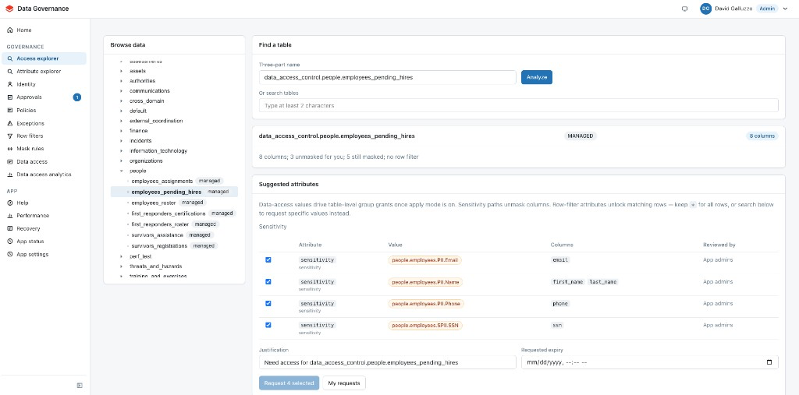

# Data Governance App: overview

**What it is.** A Databricks App that governs who can see what in Unity Catalog. It answers
three questions for every table: *who may query it*, *which sensitive columns they may see
unmasked*, and *which rows they may see*. Approvers grant those rights as expiring
attributes, and the app turns approved attributes into UC groups, grants, masks, and row
filters.

*Access explorer as an admin. The full side nav is visible, including Approvals, policies, mask
rules, data access, analytics, and app settings.*

## What it does

| Area | What users get |
| --- | --- |
| **Access explorer** | Pick a table and see which columns are masked, which row filter applies, and which attributes unlock the rest. |
| **Identity and attributes** | Attributes are `data_access` (table access), `sensitivity` (column unmasking), and row-filter dimensions. Assign, revoke, and set expiry. |
| **Approvals and requests** | Users request attributes; category approvers or admins decide. My requests and My access show status. |
| **Policies and exceptions** | Read-only view of metastore and catalog ABAC policies, plus exception management. |
| **Mask rules and row filters** | Admins define mask and row-filter rules; the app regenerates the Unity Catalog functions and policies. |
| **Data access sync** | Turns reviewed table tags into account groups, memberships, and `GRANT`/`REVOKE` statements. Runs on a schedule and on demand, with dry run first. |
| **Data access analytics** | Admin dashboard with three tabs: **Data usage** (reads and sensitive-column access from UC lineage), **Access reports** (who holds access vs who uses it, unused access, reads without an assigned grant, CSV exports), and **Sync health** (run history). |
| **Recovery and app settings** | Git export and import of app configuration, cache and storage settings, and performance views. |

Admins see the full navigation. Everyone else sees Home, Access explorer, Identity, and Help.

## Tech stack

| Layer | Technology |
| --- | --- |
| Platform | Databricks Apps (sign-in through the Apps proxy), Unity Catalog, Lakeflow Jobs |
| Backend | Python 3.11+, FastAPI, Pydantic v2, Uvicorn, Databricks SDK, psycopg (Lakebase), cachetools |
| Storage | Lakebase Postgres (default) or Delta tables, chosen per deployment |
| Usage analytics | Daily Lakeflow Job (06:00 UTC) reading `system.access` lineage into `{catalog}.usage` summary tables |
| Frontend | React 19, TypeScript, Vite 8, TanStack Query, React Router 7, Recharts, Mermaid |
| Testing | pytest (backend, coverage gate 90%), Vitest and Testing Library (frontend), Ruff |
| Delivery | Declarative Automation Bundle (`databricks.yml`) and `scripts/deploy.sh`: builds the UI, deploys the app and jobs, runs an idempotent setup job |

## How it is deployed

One bundle creates the app, the Lakebase project and database, the setup job, the grants sync
job, and the usage rollup job. The setup job creates the app catalog, the Delta tables, and the
masking UDFs. A separate **Account Admin service principal** handles metastore ABAC and the
usage rollup. Its credentials live in a Databricks secret scope.

Admin access is granted through the `admin_group` variable (default `admins`).
