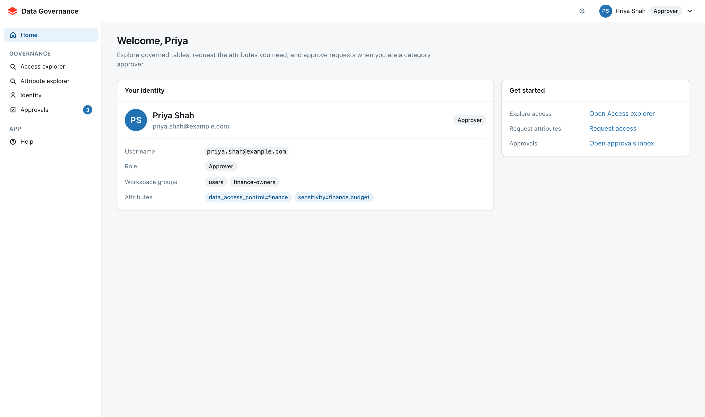
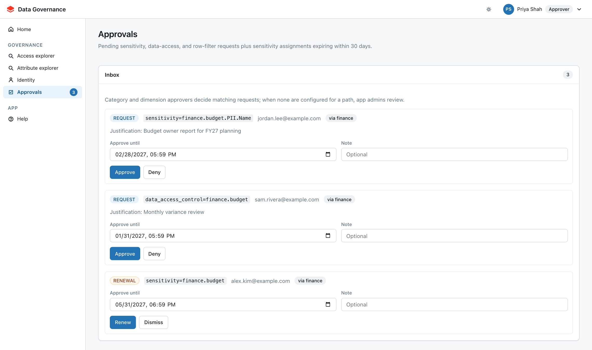
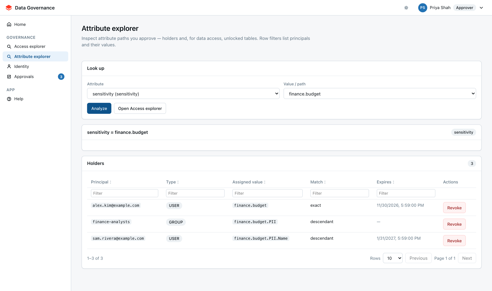
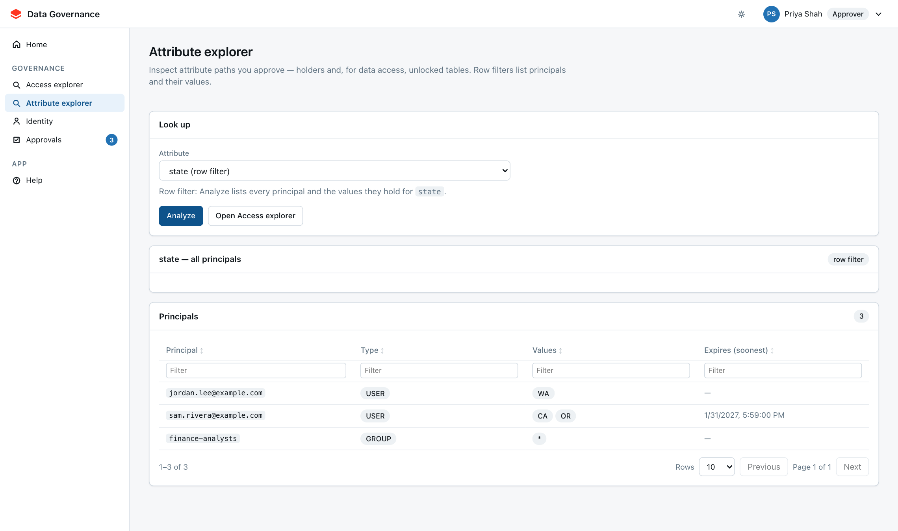

# Approver guide

This guide is for approvers: people, or members of groups, that an app admin has made
responsible for a sensitivity category, a data-access path, or a row-filter dimension. You can
also do everything in the [User guide](?tab=user). The screenshots use demo data: Priya Shah,
a member of `finance-owners`, which approves the `finance` category.

---

## What changes when you are an approver

Two extra pages appear in your side nav, and the **Approvals** badge counts the items waiting
for you.

| Page | What it is for |
| --- | --- |
| **Approvals** | Decide pending requests and renew expiring access |
| **Attribute explorer** | See who holds a path, revoke access, and see which tables a data-access value unlocks |
| **Access explorer** / **Identity** | The same as any user: explore tables and request access for yourself |

Admin configuration — who the approvers are, attribute definitions, masks, row-filter packs,
and grants sync — stays on admin-only pages.

---

## What you approve

An admin assigns you (or your group) to one or more of these:

| Approver type | Covers | Example |
| --- | --- | --- |
| **Sensitivity category** | Sensitivity paths under a category prefix | `finance` covers `finance.budget.PII.Name` |
| **Data-access path** | `data_access_control` values under a path | `finance` covers `finance.budget` |
| **Row-filter dimension** | Every value of one dimension | `state` covers `state=CA` and `state=*` |

The most specific match wins. If `finance.budget` has its own approver, its requests go there
instead of to `finance`. When nothing matches, the request goes to **app admins**.

---

## Approvals inbox

Open **Approvals** from the side nav. Each card is either a new **REQUEST** or a **RENEWAL** of
access that is about to expire.

Each card shows:

- the attribute and value requested, for example `sensitivity=finance.budget.PII.Name`
- who is asking
- **via** *category*, the approver category that routed it to you, or **app admins**
- the requester's **Justification**

### Approve or deny a request

1. Read the justification. If it is vague, deny it with a note asking for detail. The
   requester sees your note under **My requests**.
2. Check **Approve until**. It starts at the expiry the requester asked for; shorten it if the
   need is temporary. It must be in the future.
3. Optionally add a **Note**, for example a ticket number or the reason for a shorter expiry.
4. Click **Approve** or **Deny**.

Approving assigns the attribute to the requester straight away. Denying closes the request
without granting anything.

### Renew expiring access

**RENEWAL** cards list sensitivity access in your categories that expires within 30 days.

- **Renew** extends the access to the **Approve until** date.
- **Dismiss** hides the card for the current expiry date. The access still expires on schedule;
  dismissing does not revoke it.

### What happens after you approve

| Attribute | Effect |
| --- | --- |
| **Sensitivity** | Matching columns unmask on the requester's next query |
| **Row filter** | The requester sees the approved rows on their next query |
| **Data access** | The requester joins the managed group now; the table grant can wait for the next grants sync |

---

## Attribute explorer

Use **Attribute explorer** for reverse lookups, for example: "who already has
`finance.budget`?" You only see the paths you are allowed to decide.

### Who holds a path

1. Choose the **Attribute** and the **Value / path**.
2. Click **Analyze**.

**Holders** lists every user and group with access to that path:

| Match | Meaning |
| --- | --- |
| **exact** | Holds exactly this path |
| **descendant** | Holds a narrower path beneath it, for example `finance.budget.PII` |
| **ancestor** | Holds a broader path above it, which also covers this one |

Click **Revoke** to remove an assignment that is no longer needed. It takes effect on the
holder's next query. For data-access values, **Tables unlocked** also lists the reviewed tables
that the value grants, each linked to Access explorer.

### Row-filter dimensions

Choose a row-filter attribute such as `state` (there is no value to pick) and click
**Analyze**. **Principals** lists everyone holding any value for that dimension, with all of
their values on one row. `*` means all rows.

---

## Good review habits

- **Least access first.** Prefer a specific path or row value over a broad one. If someone asks
  for `state=*` but only works one region, deny with a note suggesting that value.
- **Expiries over permanent access.** Shorter approvals cost little, because renewals come back
  to your inbox.
- **Check before approving.** Use Attribute explorer to see whether a teammate or group already
  covers the need, for example through a group the requester could join.
- **Clean up.** Review your paths periodically and revoke access for people who have moved on.

---

## FAQ

**A request I expected is not in my inbox.** A more specific approver may own that path, or it
went to app admins because no approver matched. Ask an app admin to check the approver setup.

**I approved data access but the user still cannot query the table.** The table grant may wait
for the next grants sync. Group membership is already in place.

**I cannot change who approves a category.** That is admin configuration. Ask an app admin.
