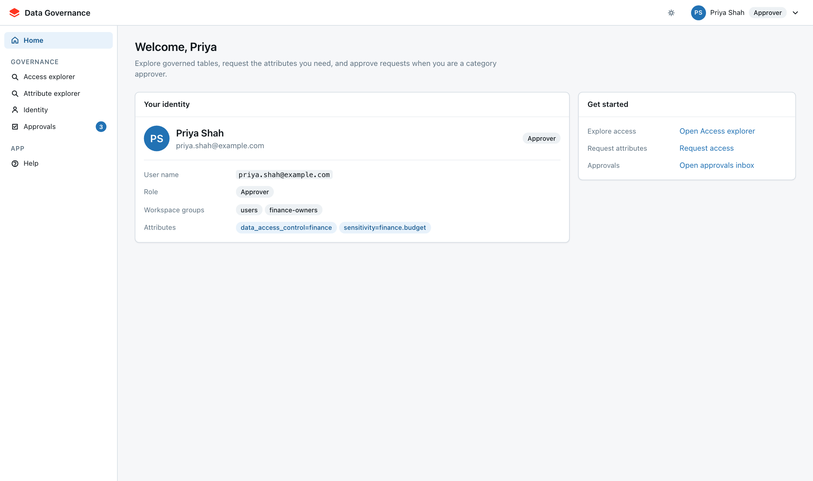
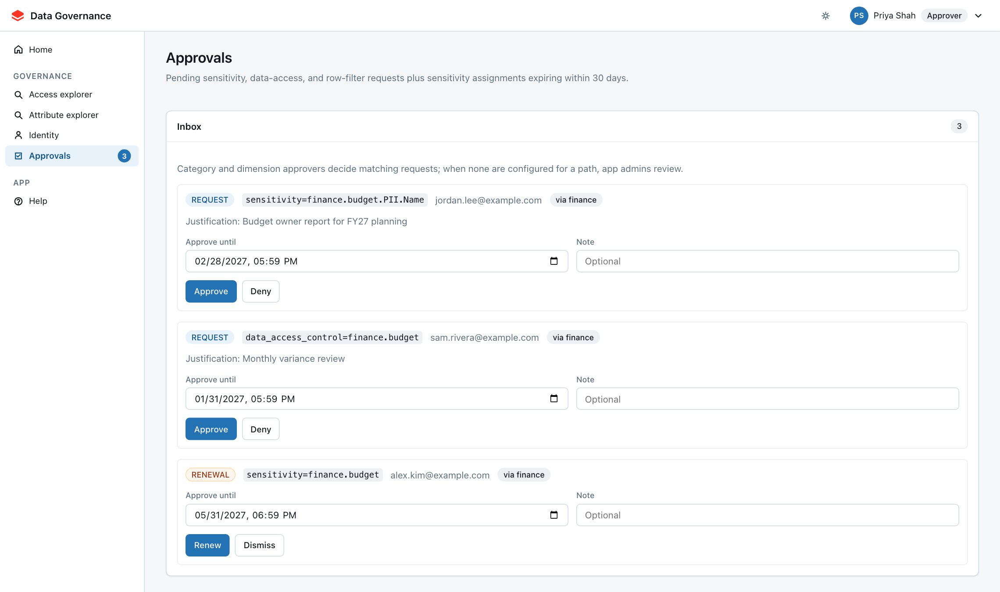
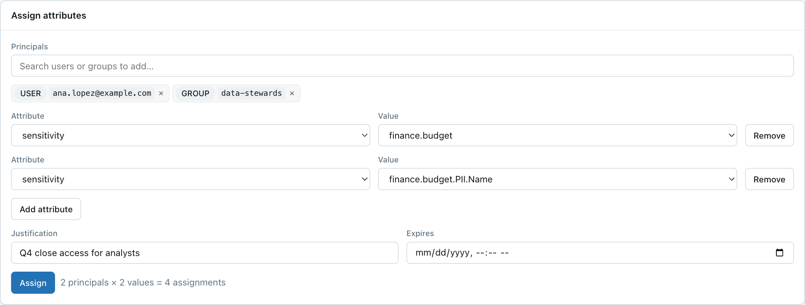
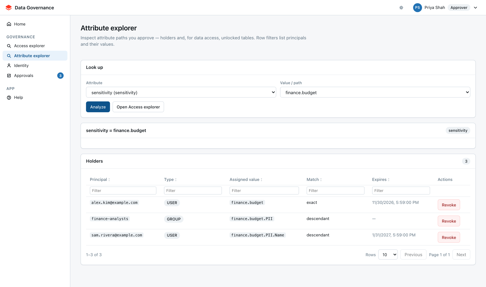
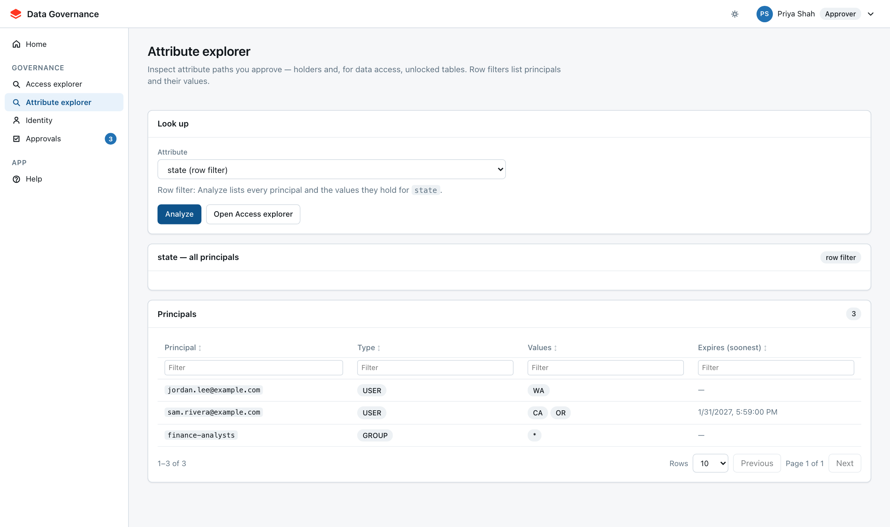

# Approver guide

This guide is for approvers: people, or members of groups, that an app admin has registered
on a data-access path. That path covers data-access, sensitivity, and row-filter requests under
it. You can also do everything in the [User guide](?tab=user). The screenshots use demo data:
Priya Shah, a member of `finance-owners`, which approves the `finance` path.

---

## What changes when you are an approver

Two extra pages appear in your side nav, and the **Approvals** badge counts the items waiting
for you.

| Page | What it is for |
| --- | --- |
| **Approvals** | Decide pending requests and renew expiring access |
| **Attribute explorer** | See who holds a path, revoke access, and see which resources that path affects |
| **Identity → Assignments** | Grant attribute values directly to users and groups (paths you can decide only) |
| **Access explorer** / **Identity** | Explore tables and request access for yourself, same as any user |

Admin configuration — who the approvers are, attribute definitions, masks, row-filter packs,
and grants sync — stays on admin-only pages.

---

## What you approve

An admin assigns you (or your group) to one or more **access paths**. Several users and groups
can share the same path.

| Request | Covered by the path | Example |
| --- | --- | --- |
| Data access | `access_path` values under the path | `finance` covers `finance.budget` |
| Sensitivity | Sensitivity values under the path | `finance` covers `finance.budget.PII.Name` |
| Row filter | Dimensions scoped to that path | `finance` covers `finance.state=CA` |

The most specific match wins. If `finance.budget` has its own approvers, its requests go there
instead of to `finance`. When nothing matches, the request goes to **app admins**.

---

## Approvals inbox

Open **Approvals** from the side nav. Each card is either a new **REQUEST** or a **RENEWAL** of
access that is about to expire.

Each card shows:

- the attribute and value requested, for example `sensitivity=finance.budget.PII.Name`
- who is asking
- **via** *category*, the approver category that routed it to you, or **app admins**
- the requester's **Justification**

### Approve or deny a request

1. Read the justification. If it is vague, deny it with a note asking for detail. The
   requester sees your note under **My requests**.
2. Check **Approve until**. It starts at the expiry the requester asked for; shorten it if the
   need is temporary. It must be in the future.
3. Optionally add a **Note**, for example a ticket number or the reason for a shorter expiry.
4. Click **Approve** or **Deny**.

Approving assigns the attribute to the requester straight away. Denying closes the request
without granting anything.

### Renew expiring access

**RENEWAL** cards list sensitivity access in your categories that expires within 30 days.

- **Renew** extends the access to the **Approve until** date.
- **Dismiss** hides the card for the current expiry date. The access still expires on schedule;
  dismissing does not revoke it.

### What happens after you approve

| Attribute | Effect |
| --- | --- |
| **Sensitivity** | Matching columns unmask on the requester's next query |
| **Row filter** | The requester sees the approved rows on their next query |
| **Data access** | The requester joins the managed group now; the table grant can wait for the next grants sync |

---

## Identity → Assignments

Use **Assignments** when you already know who should get access and want to grant it without
waiting for a request. Open **Identity**, then the **Assignments** tab.

You only see attribute keys you are designated for, and the server still checks each value
against the paths you can decide. App admins see every definition.

1. Add one or more **Principals** (users or groups) from the search box. Each selection becomes
   a chip; remove a chip if you added the wrong person.
2. Choose an **Attribute** and **Value**. Click **Add attribute** for another row when several
   values should go out together.
3. Optionally enter one shared **Justification** and **Expires** — both apply to every grant in
   this submit.
4. Check the preview (`N principals × M values = K assignments`), then click **Assign**.

Each principal × value is still created and audited as its own assignment (the same as approving
one request). The summary shows how many were created or renewed, already held, or failed. Partial
success is normal: successful grants stay in place even if some rows fail.

The table under the form lists active assignments for paths you can decide. **Revoke** removes
one grant the same way Attribute explorer does.

Caps per submit: 50 principals, 20 attribute rows, 500 grants.

---

## Attribute explorer

Use **Attribute explorer** for reverse lookups, for example: "who already has
`finance.budget`?" You only see the paths you are allowed to decide.

### Who holds a path

1. Choose the **Attribute** and the **Value / path**.
2. Click **Analyze**.

**Holders** lists every user and group with access to that path:

| Match | Meaning |
| --- | --- |
| **exact** | Holds exactly this path |
| **descendant** | Holds a narrower path beneath it, for example `finance.budget.PII` |
| **ancestor** | Holds a broader path above it, which also covers this one |

Click **Revoke** to remove an assignment that is no longer needed. It takes effect on the
holder's next query. The resources card below holders depends on the attribute kind:

| Kind | Resources card |
| --- | --- |
| **Data access** | **Tables unlocked** — reviewed tables the path grants, linked to Access explorer |
| **Sensitivity** | **Columns affected** — columns tagged with that sensitivity path (or a descendant) |
| **Row filter** | **Tables filtered** — columns tagged `row_filter=<dimension>` |

### Row-filter dimensions

Choose a row-filter attribute such as `state` (there is no value to pick) and click
**Analyze**. **Principals** lists everyone holding any value for that dimension, with all of
their values on one row. `*` means all rows. **Tables filtered** lists every table column
tagged with that dimension.

---

## Good review habits

- **Least access first.** Prefer a specific path or row value over a broad one. If someone asks
  for `state=*` but only works one region, deny with a note suggesting that value.
- **Expiries over permanent access.** Shorter approvals cost little, because renewals come back
  to your inbox.
- **Check before approving.** Use Attribute explorer to see whether a teammate or group already
  covers the need, for example through a group the requester could join.
- **Assign when you already know.** Prefer **Identity → Assignments** for planned grants to
  several people; leave Approvals for inbound requests you need to review.
- **Clean up.** Review your paths periodically and revoke access for people who have moved on.

---

## FAQ

**A request I expected is not in my inbox.** A more specific approver may own that path, or it
went to app admins because no approver matched. Ask an app admin to check the approver setup.

**I approved data access but the user still cannot query the table.** The table grant may wait
for the next grants sync. Group membership is already in place.

**I cannot change who approves a category.** That is admin configuration. Ask an app admin.

**I do not see the Assignments tab.** You must be listed (or in a listed group) as an approver for
at least one path. Ask an app admin to check **Identity → Approvers**.

**Assign failed for one value but others succeeded.** Out-of-scope or invalid values are listed in
the result summary; in-scope grants are kept. Fix the failed rows and submit again.
