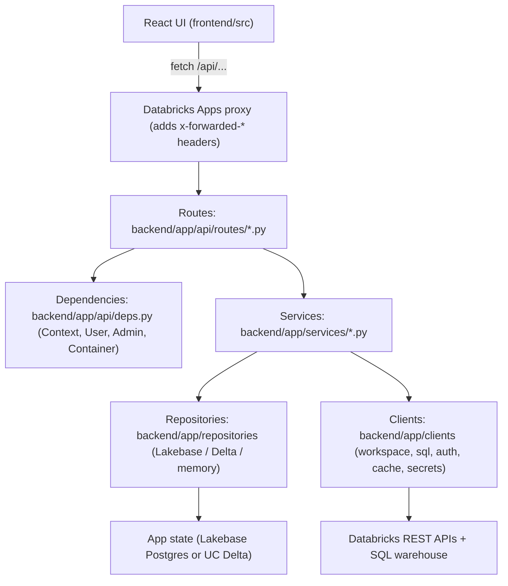
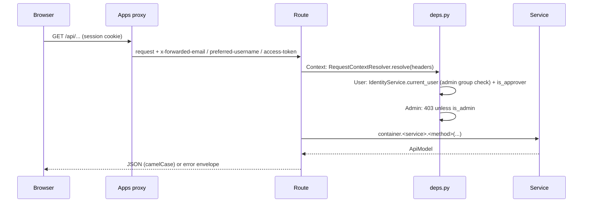
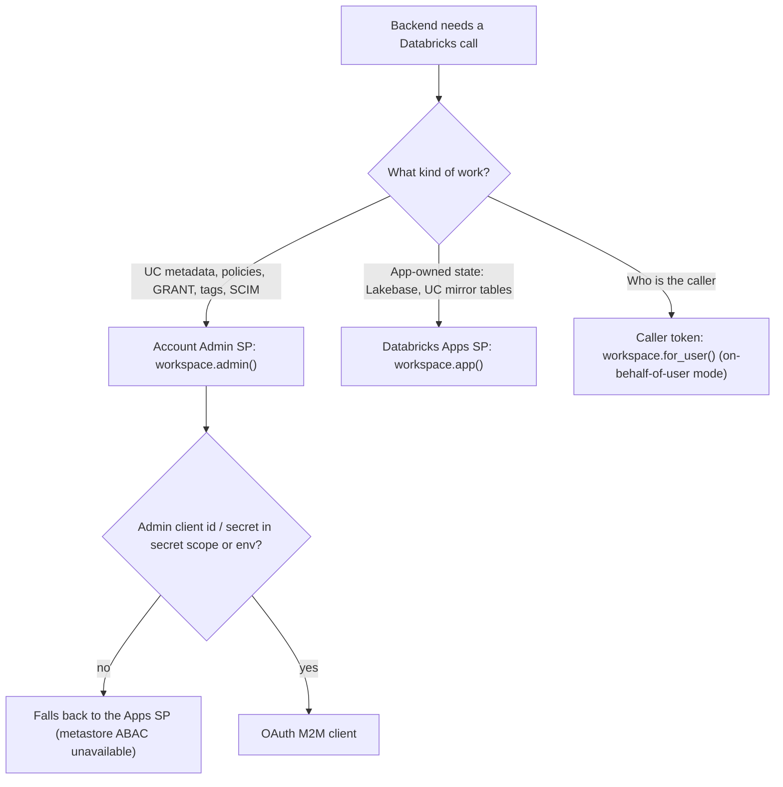

# Backend & APIs

How the FastAPI backend is put together: request path, identities, storage, services, and which
Databricks APIs each feature calls. The **API reference** tab on this page is generated from the
live route table, so it always matches the deployed code.

---

## Layers

| Layer | Responsibility | Rule |
| --- | --- | --- |
| Routes | HTTP shape, auth dependency, call one service method | No business logic, no SDK calls |
| Services | Business rules, orchestration, SQL generation | Storage-agnostic (use repository interfaces) |
| Repositories | Persist app state | Same interface for every backend (`repositories/base.py`) |
| Clients | Databricks SDK clients, SQL execution, caching | Identity choice lives here |
| Models | Pydantic `ApiModel`: snake_case in Python, camelCase on the wire | Shared by routes and services |

`ServiceContainer` (`backend/app/core/container.py`) builds every client and service once per
process, then `startup()` loads admin credentials, initializes storage, mirrors identity and mask
registries to UC, and starts the grants-sync scheduler.

---

## Request path

Errors raise `AppError` subclasses (`backend/app/core/errors.py`) and render as
`{"error": {"code", "message", "details"}}`:

| Error | HTTP | Typical cause |
| --- | --- | --- |
| `InvalidRequestError` | 422 | Bad value, wrong state, lock held, apply not ready |
| `UnauthorizedError` | 401 | No forwarded identity |
| `ForbiddenError` | 403 | Non-admin on admin route, not an approver |
| `NotFoundError` | 404 | Unknown id / slug |
| `UpstreamError` | 502 | Databricks API or SQL failed or timed out |
| `NotConfiguredError` | 503 | Warehouse, Lakebase, or admin SP missing |

---

## Identities

The backend calls Databricks as one of three identities.

| Identity | Built by | Used for |
| --- | --- | --- |
| Account Admin SP | `WorkspaceClientFactory.admin()` from `ADMIN_SECRET_SCOPE` | `SqlExecutor` (container `sql`), tag policies, ABAC policies, Account SCIM, model serving |
| Apps SP | `WorkspaceClientFactory.app()` (default SDK auth) | App-state SQL (`app_sql`), UC mirror writes, local dev identity |
| Caller | `WorkspaceClientFactory.for_user(token)` | Current-user lookup when `AUTH_MODE=on_behalf_of_user` |

---

## Storage

`build_storage` picks one backend from `STORAGE_BACKEND`; services only see `StorageProvider`.

| Backend | Use | Notes |
| --- | --- | --- |
| `lakebase` | Production OLTP | Identity and mask registries are also mirrored to UC Delta so UDFs can read them |
| `delta` | Simple deployments | UDFs read the same Delta tables directly |
| `memory` | Tests, local dev | Lost on restart |

Repositories: settings (including grants-sync settings, runs, lock), audit, identity attributes,
access requests, category approvers, mask rules, policy exceptions, request metrics.

Lakebase also owns the `request_metrics` table (one row per `/api` request: activity, status,
total milliseconds, and warehouse and Lakebase split) and the `data_access_*_v` SQL views over the
stored sync runs. Other backends keep request metrics in process memory only.

Grants-sync state lives in four more Lakebase tables, written by both the app SP (immediate
membership on approval) and the Admin SP (sync Job): `data_access_gap_items` and
`data_access_gap_meta` (full outstanding work from the last run), `data_access_tag_snapshot` and
`data_access_tag_changes` (table tagging and changes between runs), and
`data_access_membership_events` (approval-time adds and removes). They use text keys rather than
serial ids; the Admin SP is granted table DML and sequence usage. Other backends keep this state
in process memory.

---

## Services and the Databricks APIs they call

| Service | File | Databricks APIs |
| --- | --- | --- |
| `IdentityService` | `services/identity.py` | `current_user.me`, `users.list`, `groups.list` (admin group, directory search) |
| `IdentityAttributeService` | `services/identity_attributes.py` | Tag policies (governed values), SQL seed queries; UC mirror via `IdentityUcSync` |
| `IdentityUcSync` | `services/identity_uc_sync.py` | Statement Execution: MERGE into `…app.identity_attributes` |
| `AccessRequestService` | `services/access_requests.py` | None directly (storage + `IdentityAttributeService.assign`) |
| `GovernedTagService` | `services/governed_tags.py` | `tag_policies.list_tag_policies / get_tag_policy / update_tag_policy` |
| `MaskRuleService` | `services/mask_rules.py` | Statement Execution (registry mirror, `CREATE FUNCTION`, `CREATE POLICY`), `serving_endpoints.query` (LLM draft) |
| `RowFilterService` | `services/row_filters.py` | Statement Execution (`CREATE FUNCTION has_row_access`, `CREATE POLICY rf_by_dimension`, `ALTER TABLE … SET TAGS`), `information_schema.column_tags` |
| `PolicyExceptionService` | `services/policy_exceptions.py` | Directory lookups; triggers mask + row-filter pack regeneration |
| `PolicyService` | `services/policies.py` | `policies.get_policy`, `information_schema` reads (read-only explorer) |
| `AccessExplorerService` | `services/access_explorer.py` | `information_schema` columns / tags / catalogs / schemas / tables |
| `AttributeExplorerService` | `services/attribute_explorer.py` | Storage + grants-sync tag inventory |
| `DataAccessService` | `services/data_access.py` | `information_schema` tags and privileges, Account SCIM Groups and Users, `users.list` (fallback), `service_principals.list`, SQL `GRANT` / `REVOKE` (parallel, `grant_concurrency`) |
| `WarehouseScaler` | `services/warehouse_scaling.py` | `warehouses.get` / `warehouses.edit` (Admin SP): raises `max_num_clusters` for the grants step, then restores it |
| `RunProfiler` | `services/data_access_profile.py` | None (in-process timers and counters per sync run; thread-local, so worker threads report through the run thread) |
| `PerformanceService` | `services/performance.py` | `apps.get`, `postgres.get_endpoint`, `warehouses.get` (Admin SP) for capacity; request metrics from storage |
| `AppCostService` | `services/app_cost.py` | `system.billing.usage` and `system.billing.list_prices` (Admin SP, billing admin); `apps.get` for the app ID |
| `AppInfoService` | `services/app_info.py` | Storage health, deployment info |

All SQL goes through `SqlExecutor` (`clients/sql.py`): Statement Execution API on
`DATABRICKS_WAREHOUSE_ID`, polling until done, then fetching every result chunk. Identifiers go
through `quote_identifier` and literals through `string_literal`; never interpolate raw input.

---

## Feature map: UI page to API to service

| UI page | API prefix | Service | Guide |
| --- | --- | --- | --- |
| Access explorer | `/api/access-explorer` | `AccessExplorerService` | Masking & row filters |
| Attribute explorer | `/api/attribute-explorer` | `AttributeExplorerService` | Masking & row filters |
| Identity, Approvals | `/api/identity` | `IdentityAttributeService`, `AccessRequestService` | Masking & row filters |
| Policies | `/api/policies` | `PolicyService` | |
| Exceptions | `/api/policy-exceptions` | `PolicyExceptionService` | Masking & row filters |
| Row filters | `/api/row-filters` | `RowFilterService` | Masking & row filters |
| Mask rules | `/api/mask-rules` | `MaskRuleService` | Masking & row filters |
| Data access | `/api/data-access` | `DataAccessService` | Grants sync |
| Data access analytics | `/api/data-access/analytics*` | `DataAccessService`, `lakebase_views` | Grants sync |
| Data access outstanding work | `/api/data-access/pending*`, `/api/data-access/tag-changes` | `DataAccessService`, `data_access_gap` | Grants sync |
| Identity access status | `/api/data-access/access-status*` | `DataAccessService`, `data_access_status` | Grants sync |
| Performance | `/api/performance` | `PerformanceService`, `performance_analytics`, `AppCostService` | Performance and app cost (below) |
| App status | `/api/app-info`, `/api/health` | `AppInfoService` | |
| Help | `/api/help` | Route only | This page |

---

## Performance and app cost

- **Request timing.** `RequestTimingMiddleware` (`core/perf.py`) times every API request and names it
  with an activity from `core/activities.py`, which has an expected time. `MetricsRecorder` queues
  the samples and writes them to storage every 5 seconds, in batches of 200.
  `performance_analytics` builds the summary, hourly roll-up, and slow-request pages from them. A
  request slower than its expected time is flagged for review; it is not an error.
- **Capacity.** `PerformanceService.capacity()` reads the app's compute size, the Lakebase endpoint,
  and the SQL warehouse size through the Account Admin SP. Each read fails separately.
- **App cost.** `AppCostService` (`services/app_cost.py`) reports app compute per UTC day, and the
  warehouse and job cost of each sync. App compute is matched by `usage_metadata.app_id`, warehouse
  cost by the dedicated warehouse, and job cost by the sync job. Warehouse and job cost count toward
  a sync only inside that run's start and finish time, pro-rated by time. Costs use list prices, not
  invoice amounts, and billing data lags by up to about a day. Reports are cached for 15 minutes;
  failed reads are reported as unavailable and are not cached.

---

## Background work

| Task | Where | Trigger |
| --- | --- | --- |
| Identity UC mirror resync | `ServiceContainer.startup` (background thread `uc-mirror-resync`) | App start (Lakebase backend); each table is replaced with one `INSERT OVERWRITE` (staged for large sources) under a lock shared with incremental writes. The sync Job does not run it (`mirror_uc=False`) |
| Mask registry mirror | `ServiceContainer.startup` | App start when rules exist |
| Grants sync scheduler | `DataAccessService.start_scheduler` | Every `interval_minutes` when `schedule_enabled` |
| Grants sync Job | Lakeflow Job `data-governance-app-data-access-sync` (`backend/jobs/run_data_access_sync.py`) | Schedule and manual runs; the Job preflights Lakebase and the Admin SP, then runs the sync with `mirror_uc=False` |
| Immediate group membership | `DataAccessService.on_assignment_event` (Identity listener) | Each data-access approval, assign, or revoke |
| Outstanding work and tag snapshot | `DataAccessService._record_state` | End of every sync run |
| Request metrics flush | `MetricsRecorder` (daemon thread) | Every 5 seconds; queued metrics are written in batches of 200 |
| Request metrics prune | `MetricsRecorder` | At most hourly; deletes rows older than 14 days |

---

## Adding an endpoint

1. Add request/response models in `backend/app/models/<feature>.py` (subclass `ApiModel`).
2. Add the service method; raise `AppError` subclasses for expected failures.
3. Add the route in `backend/app/api/routes/<feature>.py` with `Admin` or `User` and a docstring
   (its first line becomes the API reference summary).
4. Register new routers in `backend/app/api/routes/__init__.py`.
5. Add the client call in `frontend/src/api/services.ts`, types in `types.ts`, hook in `queries.ts`.
6. Add backend tests in `backend/tests/` and UI tests in `frontend/src/test/`.
