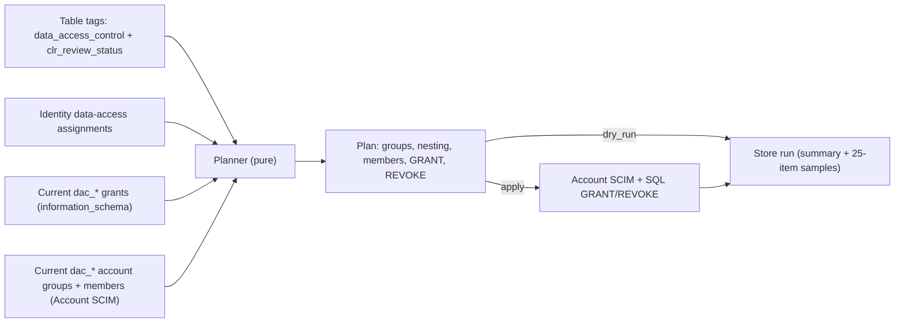
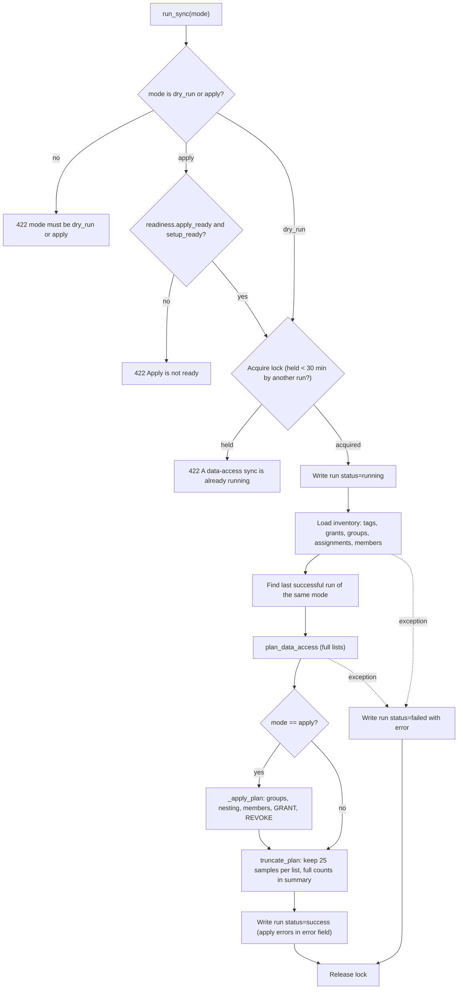
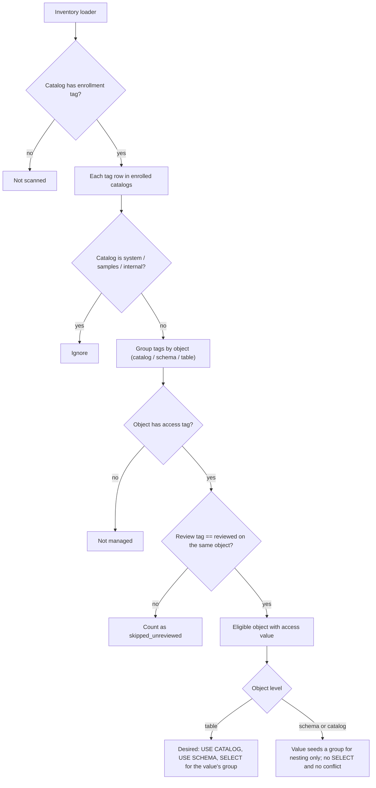
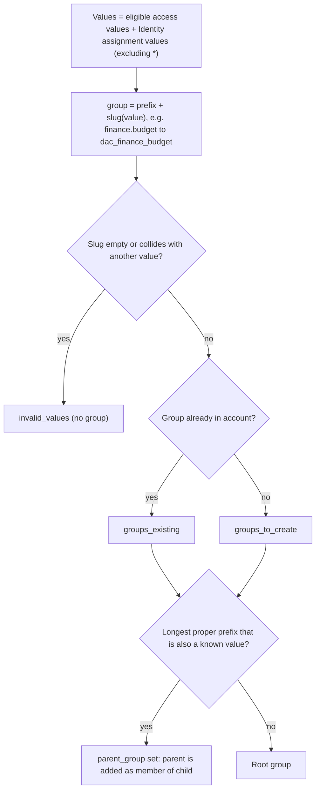
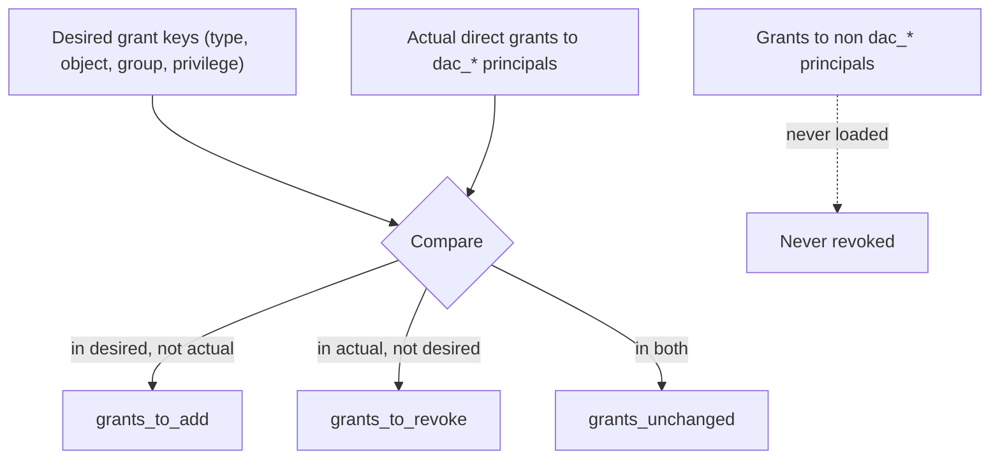
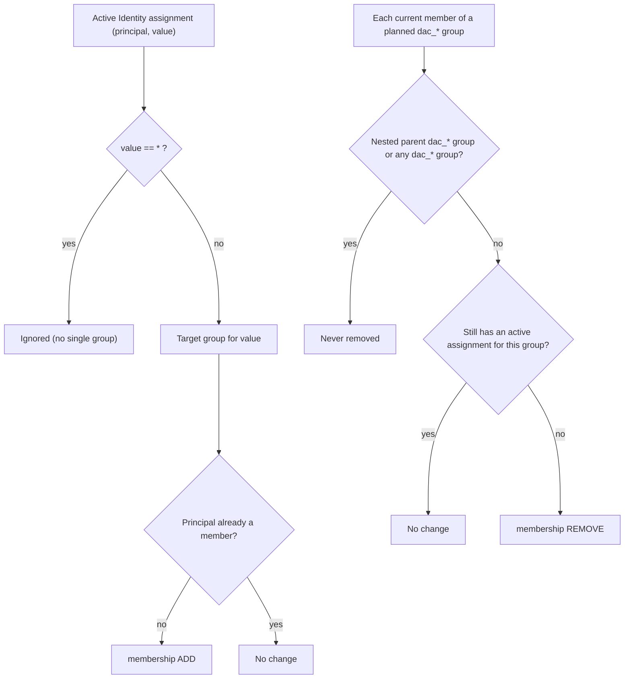
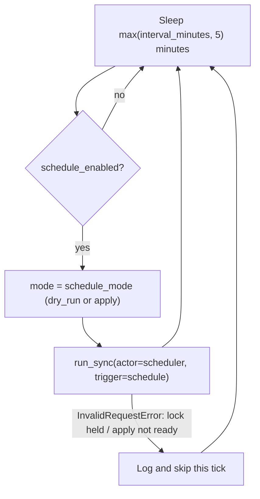

# Grants sync (data-access groups)

The grants sync turns **table tags** and **Identity data-access assignments** into Unity
Catalog **account groups**, **group membership**, and **GRANT / REVOKE** statements. It is the
only part of the app that issues UC privileges; masks and row filters are ABAC policies and do
not depend on grants.

UI: `/data-access` (admin only) · API: `/api/data-access/*`

| Area | Primary files |
| --- | --- |
| Orchestration, inventory, apply, scheduler | `backend/app/services/data_access.py` |
| Pure planner (no Databricks calls) | `backend/app/services/data_access_planner.py` |
| Models, limits, settings | `backend/app/models/data_access.py` |
| Routes | `backend/app/api/routes/data_access.py` |
| UI | `frontend/src/pages/dataAccess/DataAccessPage.tsx` |

---

## Mental model

1. A table is **eligible** when it carries **both** the access tag (`data_access_control`) and
   the review tag (`clr_review_status = reviewed`) **on the table itself**. Tags on the parent
   schema or catalog are **not** inherited onto the table.
2. Each distinct access value becomes a managed account group: `finance.budget` →
   `dac_finance_budget`.
3. Hierarchical values nest: `dac_finance` is added as a **member of** `dac_finance_budget`, so
   anyone in `dac_finance` inherits every `finance.*` grant.
4. Each eligible table gets `SELECT` for its group, plus `USE CATALOG` / `USE SCHEMA` on the
   parents so the table is reachable.
5. People get into groups through **Identity assignments** of the data-access attribute
   (directly or through an approved access request). Removing the assignment removes them from
   the group on the next apply.
6. Anything granted to a `dac_*` principal that is **not** in the desired set is revoked. Grants
   to non-`dac_*` principals are never touched.



---

## Settings

Stored as JSON in the app settings store under `data_access`.

| Setting | Default | Meaning |
| --- | --- | --- |
| `access_tag_key` | `data_access_control` | Tag whose value names the group |
| `review_tag_key` / `review_tag_value` | `clr_review_status` / `reviewed` | Must also be on the same object |
| `group_prefix` | `dac_` | Managed-group prefix; only `dac_*` principals are ever revoked |
| `hierarchy_separator` | `.` | Splits values into parents for nesting |
| `enrollment_catalog_tag_key` / `enrollment_catalog_tag_value` | `data_access_controlled` / `true` | Catalog tag that enrolls a catalog; sync and Access Explorer only see tagged catalogs |

When the app first sees an enrolled catalog, it grants the Account Admin SP `MANAGE`, `USE CATALOG`, `USE SCHEMA`, and `SELECT` on that catalog (also done by the setup job at deploy). `SELECT` is required so Identity seed queries and inventory reads against tables in the catalog succeed; `MANAGE` is required for `dac_*` GRANT/REVOKE.
| `allowed_catalogs` | empty | Deprecated / ignored (perimeter is enrollment tags only) |
| `data_privileges` | `SELECT` | Privileges granted on each eligible table |
| `interval_minutes` | 15 (min 5) | Scheduler interval |
| `schedule_enabled` | true | Pause switch for the scheduler |
| `schedule_mode` | `dry_run` | `dry_run` = plan only; `apply` = plan then mutate in the same run |
| `grant_concurrency` | 64 (1–64) | Hard cap on in-flight GRANT/REVOKE statements; actual workers = size × clusters |
| `membership_concurrency` | 8 (1–32) | Parallel membership resolve/patch workers (patches to the same group stay sequential) |
| `warehouse_autoscale` | false | Raise the SQL warehouse's `max_num_clusters` for the grants step, then leave the baseline |
| `warehouse_max_clusters` | 8 (1–10) | Ceiling during the grants phase (leave headroom so UI users are not starved by the sync) |
| `warehouse_baseline_clusters` | 4 (1–10) | Ceiling after the grants phase, and the cluster count used for grant concurrency |

Saving settings replaces only the fields the request sends. Fields it leaves out keep their stored
values, so a client that does not know a newer setting cannot reset it to the default.

---

## Run lifecycle (dry-run and apply)

Every run, whether manual (`POST /api/data-access/runs`) or scheduled, goes through
`DataAccessService.run_sync`.



Notes:

- Apply always works from the **full** plan; only the stored run record is truncated, so a sync
  over thousands of tables applies every change in one run.
- Per-step apply errors (for example one GRANT failing) are collected, not fatal: the run is
  `success` with the errors joined into `error`, and the next run retries anything still missing.
- Drift notes compare this plan's fingerprint with the last successful run **of the same mode**.

---

## Inventory: what is read and how

| Input | Source | Called as |
| --- | --- | --- |
| Catalog tags | `system.information_schema.catalog_tags` | Account Admin SP via SQL warehouse |
| Schema tags | `system.information_schema.schema_tags` | Same |
| Table tags | `system.information_schema.table_tags` | Same |
| Catalog grants | `system.information_schema.catalog_privileges` (grantee `LIKE 'dac\_%'`) | Same |
| Schema grants | `system.information_schema.schema_privileges` | Same |
| Table grants | `system.information_schema.table_privileges` | Same |
| Managed groups | `GET /api/2.0/account/scim/v2/Groups?filter=displayName sw "dac_"` | Account Admin SP (workspace-proxied Account SCIM) |
| Group members | Same call with `attributes=id,displayName,members` | Same |
| Desired members | App storage: active assignments of the data-access Identity definition | App storage |

Only **direct** grants count. `information_schema` reports `inherited_from = 'NONE'` for direct
grants; anything else (`CATALOG`, `SCHEMA`) is inherited and skipped so the sync never tries to
revoke a privilege it cannot see at that level.

Privilege names are normalized before diffing: `information_schema` returns `USE_CATALOG` /
`USE_SCHEMA` (underscores), while GRANT SQL uses `USE CATALOG` / `USE SCHEMA` (spaces). The
planner maps both to the spaced form so already-granted traversal privileges are not endlessly
re-added and revoked.

---

## Planner decision flow

`plan_data_access` is pure: the same inputs always give the same plan.



### Groups and nesting



### Grant diff



`USE CATALOG` / `USE SCHEMA` are shared across tables, so they are only revoked when **no**
remaining eligible table for that group lives in the catalog or schema.

Example: retagging `sandbox.default.us_states` from `public` to `non-public` makes
`dac_public` SELECT, USE SCHEMA, and USE CATALOG (if nothing else needs them) undesired, so they
are revoked, and `dac_non_public` gets the same three grants.

### Membership diff



Expired or revoked assignments are inactive, so the principal is removed on the next apply.

### Immediate membership on approve, assign, and revoke

Membership does not wait for the sync. `IdentityAttributeService` calls its listeners after
every new assignment and every revoke; `DataAccessService.on_assignment_event` handles the
data-access attribute:

| Event | What happens right away | What still waits for the sync |
| --- | --- | --- |
| Approval or admin assign | Find the path's `dac_*` account group, create it if missing, add the principal | Parent nesting and table grants for a newly created group |
| Revoke | Remove the principal, unless another active assignment still maps to the same group | Nothing |
| Expiry | Nothing (expiry is only noticed when a sync reads assignments) | Removal at the next apply |
| Renewal (expiry change) | Nothing (membership is unchanged) | Nothing |

Every attempt is recorded in `data_access_membership_events`. Failures never fail the
approval: the item is listed as failed outstanding work and the next apply retries it. Without
an Account Admin SP the event is recorded as skipped and left for the sync.

Access needs both halves: membership in the path's group and the path's structure (the group,
its parent nesting, and the table grants). A user added to a group that the approval just
created is a member, but has no table access until the next apply nests the parent and grants
SELECT. The Identity pages show this per assignment (see Access status below).

Member inventory resolves USER entries to Account SCIM ``userName`` (email). Group membership
APIs often return only the display name (``David Galluzzo``), while Identity assignments store
the email. Without that resolution the plan would add the email and remove the display name —
both resolve to the same SCIM id, so apply would add then remove the person. Apply also collapses
ADD+REMOVE pairs that share a SCIM id, keeping only the ADD.

---

## Apply order and APIs

`_apply_plan_impl` runs four steps in a fixed order so each step can rely on the previous one.

```mermaid
sequenceDiagram
  participant S as DataAccessService
  participant SCIM as Account SCIM (via workspace)
  participant SQL as SQL warehouse (Account Admin SP)
  S->>SCIM: GET /api/2.0/account/scim/v2/Groups (id map)
  loop each planned group missing an id
    S->>SCIM: POST /Groups {displayName}
  end
  loop each group with parent_group
    S->>SCIM: PATCH /Groups/{child} add members [parent]
  end
  loop each membership change (membership_concurrency at a time; one group's patches stay sequential)
    S->>SCIM: resolve principal id (Groups filter / users.list / service_principals.list)
    S->>SCIM: PATCH /Groups/{group} add or remove member
  end
  loop each grant to add or revoke (grant_concurrency at a time)
    S->>SQL: GRANT / REVOKE privilege ON securable TO dac_group
  end
```

| Step | API | Idempotency |
| --- | --- | --- |
| Create groups | `POST /api/2.0/account/scim/v2/Groups` | On failure re-lists by `displayName eq` and reuses the id |
| Nest groups | `PATCH /Groups/{child}` `op=add path=members` | Links already in the inventory (`nest_exists`) are skipped; "already exists" responses are ignored |
| Members | `PATCH /Groups/{group}` add / `remove members[value eq "id"]` | Add ignores "already exists" |
| Resolve users | Account SCIM `GET /api/2.0/account/scim/v2/Users?filter=userName eq "…"`, then `users.list` on the workspace as a fallback | Account users who are not provisioned to this workspace are found by the first call |
| Resolve SPs | `service_principals.list(filter=applicationId eq / displayName eq)` | |
| GRANT / REVOKE | Statement Execution API on `DATABRICKS_WAREHOUSE_ID` | UC treats repeats as no-ops |

### Parallel grants

The grants step is the largest cost at scale (one statement per table and principal), so
statements run through a thread pool. Each statement is independent, and the warehouse queues
whatever it cannot run yet.

- Pool size is `12 × warehouse_baseline_clusters`, capped by `grant_concurrency` (default 12×4=48).
  Concurrency uses the baseline, not the sync ceiling, so the sync does not fill every cluster.
  12 per cluster comes from a Small serverless probe; a stage 1 apply at 16×4=64 raised average
  grant latency to ~1.6 s.
- During sync the warehouse ceiling is raised to `warehouse_max_clusters` (default 8) so UI users
  still have room. After sync it is set to `warehouse_baseline_clusters` (default 4), not back to 1.
- Results are handled on the run's own thread: failures are appended to `error` and keyed for
  the outstanding list exactly as before, so one failed statement never stops the rest.
- A failed statement is retried by the next run, as before.

### Parallel membership

Membership changes are resolved and patched through a thread pool, sized by `membership_concurrency`
(default 8, range 1–32). Resolving a principal to its SCIM id and patching a group both run in
parallel. Patches to the same group stay sequential, so two edits never race on one group.

Before a run, ADD and REMOVE pairs for the same person under different names (email and display
name) are collapsed. Nests that the inventory already shows as present are skipped.

### Warehouse capacity and scaling

Grant statements are small, so throughput comes from how many run at once. The bundle creates a **dedicated** SQL warehouse for the app and its sync job (`resources/warehouse.yml`, named `<app name>-warehouse`: Small, serverless, auto-stop after 10 minutes). Nothing else uses it, so scaling it does not affect BI users, and its billing records are the app's own cost. The grants phase works like this:

1. The run plans the changes and counts the grant statements.
2. The Account Admin SP reads the warehouse size and current `max_num_clusters`.
3. If `warehouse_autoscale` is on and there are grants, it raises `max_num_clusters` to
   `warehouse_max_clusters` (default 8) so the sync and UI can share capacity.
4. Grant concurrency is `12 × warehouse_baseline_clusters` (default 48), capped by
   `grant_concurrency`, so the sync does not consume the full ceiling.
5. After the grants phase (including on error), `max_num_clusters` is set to
   `warehouse_baseline_clusters` (default 4) so the app always keeps room to scale.

Scaling is best-effort. If the warehouse cannot be read or edited, the notice is recorded on the
run profile and grants run with baseline concurrency. Cluster size stays Small; horizontal scaling
fits many small statements better than a larger cluster.

Scaling applies to apply runs only (dry runs issue no grant statements). A deploy resets the cluster range to the bundle's values (1 to 1); the next apply run raises it again when `warehouse_autoscale` is on.


Groups must be **account** groups. Workspace-local groups created with the workspace Groups API
are invisible to Unity Catalog and fail `GRANT` with `PRINCIPAL_DOES_NOT_EXIST`.

---

## Scheduler

A daemon thread (`data-access-sync`) started in `ServiceContainer.startup`.



The lock lives in the settings store (`data_access_lock`), so a manual run and a scheduled run
never overlap. Locks older than 30 minutes are treated as stale.

---

## Readiness

`GET /api/data-access/readiness`.

| Check | Needed for | How it is probed |
| --- | --- | --- |
| `credentials` | dry-run | Account Admin SP client id / secret present |
| `authenticate` | dry-run | `current_user.me()` as the admin SP |
| `warehouse` | dry-run | `DATABRICKS_WAREHOUSE_ID` configured |
| `read_tags` | dry-run | `SELECT … FROM system.information_schema.catalog_tags LIMIT 1` |
| `list_groups` | dry-run | `groups.list` as the admin SP |
| `create_groups` | apply | Assumed when admin SP is configured (not exercised) |
| `grants` | apply | `SELECT … FROM system.information_schema.catalog_privileges LIMIT 1` |
| `sensitivity_definition` | apply (setup) | Identity definition with key `sensitivity` exists |
| `data_access_definition` | apply (setup) | Identity definition linked to the access tag exists |

---

## Run history

| Endpoint | Returns |
| --- | --- |
| `GET /api/data-access/runs?mode=&page=&page_size=` | Last 30 days, newest first, summaries only (no plan) |
| `GET /api/data-access/runs/latest?mode=` | Latest run with its sampled plan |
| `POST /api/data-access/runs` `{mode}` | Runs now and returns the finished run |
| `GET /api/data-access/analytics?days=` | KPIs, daily activity, recent failures, and fingerprint history (admin) |
| `GET /api/data-access/analytics/runs?mode=&page=&page_size=` | One page of `data_access_runs_v`, newest first (Lakebase only) |
| `GET /api/data-access/analytics/grants?mode=&change=&page=&page_size=` | One page of `data_access_run_grants_v`, newest run first (Lakebase only) |

Runs are pruned on write: older than 30 days or beyond 500 records. Each stored plan keeps up to
25 sample rows per list; `summary` always holds the full counts and `truncated` says whether
samples were cut.

### Run profile and progress logs

Each run stores a `profile` next to its summary (failed runs keep theirs) and the same JSON is
logged once as a `data_access_profile` line. It answers "where did the time go" without
re-running:

| Field | Contents |
| --- | --- |
| `phases` | Seconds per step: `inventory`, `plan`, `apply.groups`, `apply.nest`, `apply.membership`, `apply.grants`, `state.*`, and `job.*` preflight steps for Job runs |
| `calls` / `call_seconds` / `call_max_seconds` | Count, total, and slowest single call per API or SQL statement type (for example `sql.grant_table`, `scim.patch_group`, `sql.read_table_privileges`) |
| `sizes` | Row and item counts (tables, grants, members, `grant_concurrency`, warehouse cluster ceilings) |
| `notes` | Warnings to read with the numbers, such as a warehouse that could not be resized |

While a step runs, the log shows progress at about 5% intervals with elapsed time and an estimate:

```text
progress grants 250 of 2500 (10%) elapsed=41s eta=371s
apply plan: groups_to_create=1 nests=0 membership=250 grants_add=2547 grants_revoke=0
```

The Job writes its preflight timings (Lakebase env, Admin SP secrets, container build, container
startup) into the same profile, so the time before planning is visible too.

Use `scripts/perf_grants.py report` to print the stored profiles of recorded performance runs.

---

## Outstanding work and tag changes

The 25-row plan samples are too small to work from at 5,000+ tables and users, so every run
also stores its **full** outstanding list (`data_access_gap_items`) and a per-table tag
snapshot. The Data access page shows both on the **Outstanding work** tab.

| Run mode | What is stored as outstanding |
| --- | --- |
| Dry run | Everything the next apply would change: groups to create, missing parent→child nesting links, members to add or remove, grants to add or revoke |
| Apply | Only the items that failed during this apply, with the error |

Approvals that apply membership while a run is in flight are not re-listed, and approval-time
failures stay listed until a sync retries them. Successful immediate membership changes delete
their outstanding member item, so the list stays current between syncs.

Nesting is listed only when the child group's members do not already include the parent group.
Expired assignments are not in the stored list (nothing has noticed them yet); they are counted
live as **Expired since sync** from Identity assignments whose expiry is after the last sync.

Tag change detection compares the table-level snapshot with the previous run's:

| Change | Meaning |
| --- | --- |
| `newly_eligible` | Table gained the access tag plus review (it will receive grants) |
| `no_longer_eligible` | Table lost the access tag or review (its grants will be revoked) |
| `value_changed` | Eligible table moved to another access path |

The first run after deploy takes a baseline and records no changes. Tag changes and membership
events are kept for 30 days.

| Endpoint | Returns |
| --- | --- |
| `GET /api/data-access/pending` | Counts by kind, failures, expired since sync, last run's tag change counts |
| `GET /api/data-access/pending/items?kind=&status=&q=&page=&page_size=` | One page of outstanding items; `kind=expired` lists expiries since the last sync |
| `GET /api/data-access/tag-changes?change=&scope=latest\|all&page=&page_size=` | Tables whose tagging changed, newest first |

## Access status

Per data-access assignment, two states:

| Membership | Meaning |
| --- | --- |
| `member` | In the path's group (applied at approval or by a sync) |
| `pending_sync` | Not added yet; the next apply adds it |
| `failed` | Immediate add or remove failed; the next apply retries |
| `removal_pending` | Revoked or expired; removed at the next apply |
| `removed` | Removed at revoke |

| Structure | Meaning |
| --- | --- |
| `ready` | No outstanding group, nesting, or grant work for the value or anything beneath it |
| `pending_sync` | The group was created at approval after the last sync, or the path (`finance` covers `finance.budget`) still has group, nesting, or grant work |

| Endpoint | Returns |
| --- | --- |
| `GET /api/data-access/access-status/me` | Status for the signed-in user's data-access attributes (any user) |
| `POST /api/data-access/access-status` `{assignmentIds}` | Status for up to 200 assignments (admin); used by Identity → Assignments for the visible page |

---

## Troubleshooting

| Symptom | Cause | Fix |
| --- | --- | --- |
| Table tagged but no group | Review tag missing on the **table** (schema tag does not count) | Tag the table with both keys |
| `PRINCIPAL_DOES_NOT_EXIST` on GRANT | Group is workspace-local | Delete it; apply recreates it as an account group |
| Old group keeps SELECT after retag | Grant was not direct or prefix differs | Check `inherited_from` and `group_prefix`; dry-run shows it under revoke |
| User not in group | No active data-access assignment, or value is `*` | Assign a concrete value in Identity |
| Scheduled apply never runs | `schedule_enabled` false, `schedule_mode` dry_run, or readiness failing | Fix settings or readiness; skipped ticks are logged |
| `resolve principal <group>: not found` on a membership removal | Member was typed as a user. Account SCIM member entries carry `$ref` (`Groups/{id}`), not `type`; older builds guessed from the display name | Fixed by reading `$ref` first; the next apply retries anything still failing |
| Apply slow in `apply.nest` with the same nests every run | Nest PATCHes are issued for every planned parent→child link, including links that already exist (Account SCIM ignores the duplicate) | Known cost (about 3 s per link); skipping links that the child already contains is a planned follow-up |
| Apply slow in `apply.grants` with `warehouse not resized` in notes | Admin SP cannot edit the warehouse, or it is a shared warehouse | Use a dedicated warehouse for the app and grant the Admin SP `CAN MANAGE`; the grants still run at the current size |
