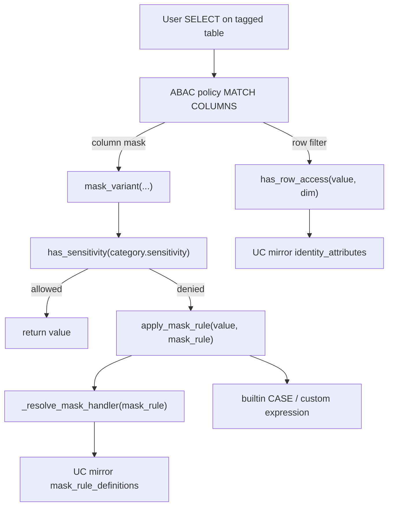
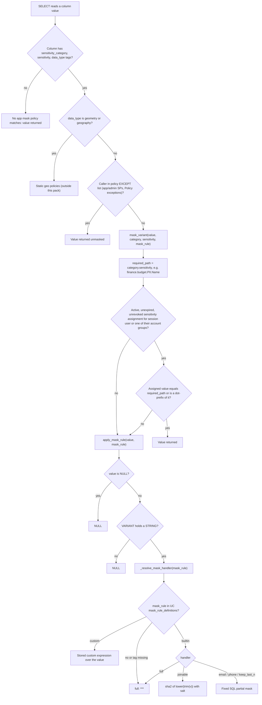
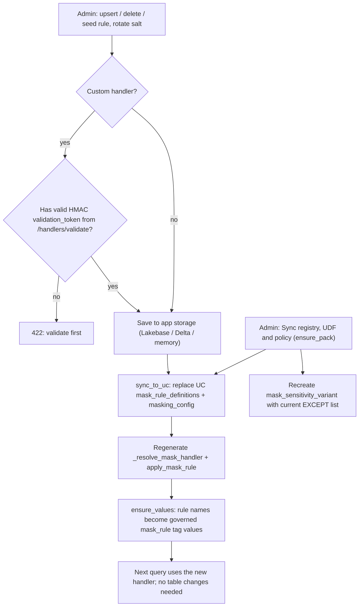
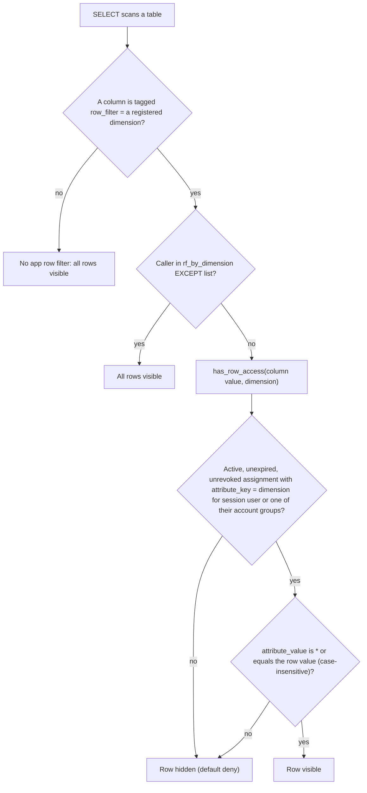
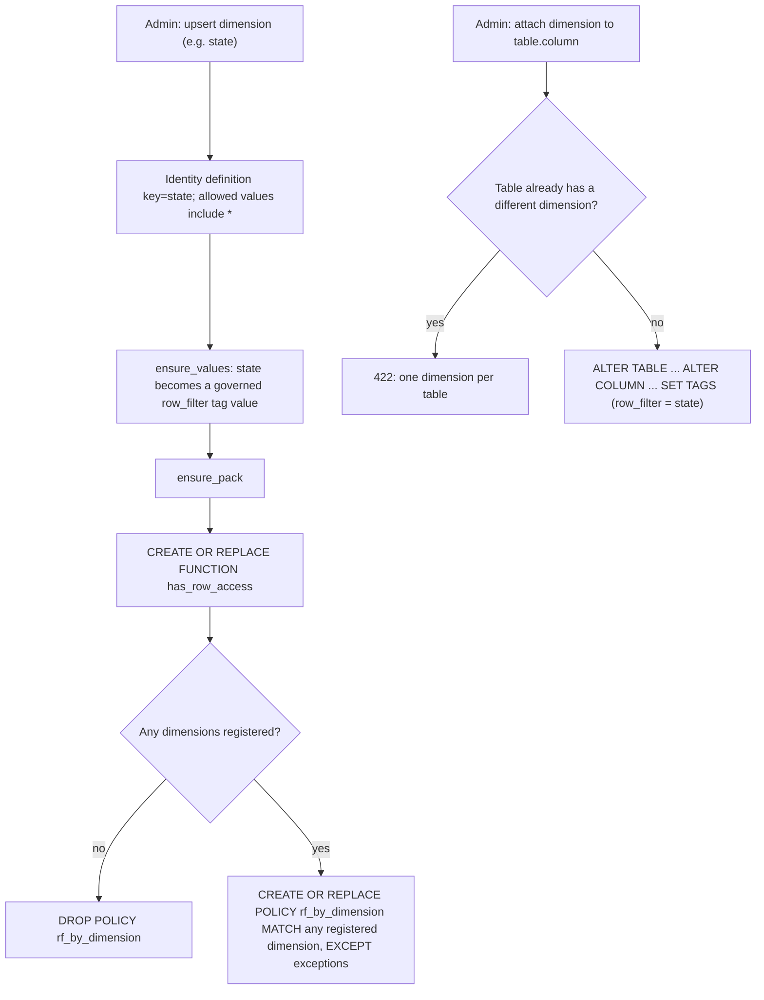
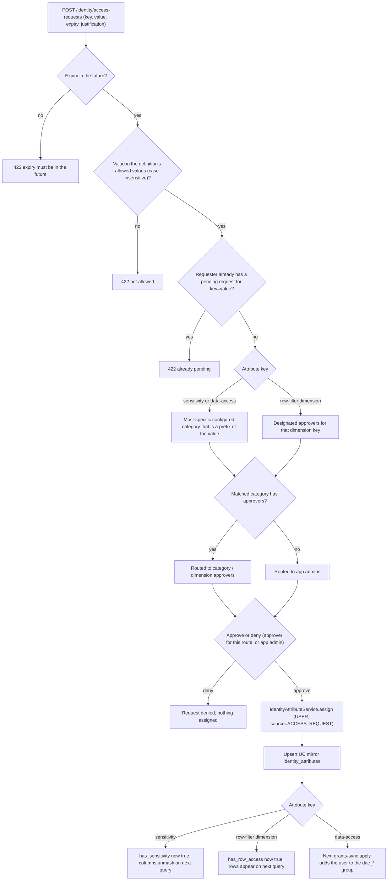

# Developer guide: column masks and row filters

This document describes the **end-to-end enforcement chain** for presentation masking and
row-level filtering as used by this app. It is the source of truth for how Unity Catalog
functions, policies, tags, and app-managed registries fit together — and which pieces the app
regenerates vs which are static.

Default catalog/schema names below assume:

| Config | Default |
| --- | --- |
| `APP_CATALOG` | `data_governance_app` |
| `APP_SCHEMA` | `app` |
| `ABAC_FUNCTION_SCHEMA` | `masking_functions` |
| `MASK_VARIANT_POLICY_NAME` | `mask_sensitivity_variant` |
| `ROW_FILTER_POLICY_NAME` | `rf_by_dimension` |
| `MASK_RULE_TAG_KEY` | `mask_rule` |
| `ROW_FILTER_TAG_KEY` | `row_filter` |

Code owners:

| Area | Primary files |
| --- | --- |
| Mask registry + pack | `backend/app/services/mask_rules.py` |
| Mask UDF SQL builders | `backend/app/services/mask_handler_sql.py` |
| Row-filter pack | `backend/app/services/row_filters.py` |
| Identity mirror for UDFs | `backend/app/services/identity_uc_sync.py` |
| Access Explorer (read path) | `backend/app/services/access_explorer.py` |
| Models | `backend/app/models/mask_rule.py`, `row_filter.py`, `access_explorer.py` |

---

## Mental model

Authorization and presentation are separate:

1. **Who may see a clear value?** Column tags `sensitivity_category` + `sensitivity` plus the
   caller’s `sensitivity` identity attribute (via `has_sensitivity`).
2. **How does a denied value look?** Column tag `mask_rule` → registry → `apply_mask_rule`.
3. **Which rows are visible?** Column tag `row_filter=<dimension>` → `has_row_access(row, dim)`.

Unity Catalog table **grants** (who may `SELECT` a table at all) are handled by the separate
tag-driven sync; see the **Grants sync** guide. This guide covers ABAC masks and row filters,
which apply only after a caller can already read the table.



---

## Column mask flow

### 1. Tags on the column (static metadata)

| Tag | Role |
| --- | --- |
| `sensitivity_category` | Left side of the required path (e.g. `finance.budget`) |
| `sensitivity` | Right side / leaf (e.g. `PII.Name`) |
| `data_type` | Routes geometry/geography to separate policies; required by the VARIANT policy match |
| `mask_rule` | Presentation algorithm name (registry key). Missing/unknown → `full` |

**Required path** checked by auth: `concat_ws('.', sensitivity_category, sensitivity)`  
Example: `finance.budget.PII.Name`.

Admins set tags in UC (`ALTER TABLE … ALTER COLUMN … SET TAGS`). The app does **not** rewrite
column tags when editing mask rules (except ensuring governed tag *values* exist for
`mask_rule`).

### 2. Metastore policy `mask_sensitivity_variant` — **app-regenerated**

Created by `MaskRuleService._recreate_variant_policy` on **Sync registry / Ensure pack**.

- Scope: `ON METASTORE`, `TO account users`, `FOR TABLES`
- Match: columns with `sensitivity_category`, `sensitivity`, `data_type` where `data_type` is
  **not** `geometry` or `geography`
- Action: `COLUMN MASK data_governance_app.masking_functions.mask_variant`
- Passes: category, sensitivity, and `mask_rule` tag values via `get_column_tag_value`

Geometry / geography columns use separate static policies
(`mask_sensitivity_geometry` / `mask_sensitivity_geography`) that are **not** owned by this
repo’s pack ensure today.

### 3. Function `mask_variant` — **static (not regenerated by the app)**

FQN: `data_governance_app.masking_functions.mask_variant(value VARIANT, sensitivity_category STRING, sensitivity STRING, mask_rule STRING) RETURNS VARIANT`

Intended body (must stay aligned with Access Explorer):

1. If `has_sensitivity(concat_ws('.', sensitivity_category, sensitivity))` → return `value`
2. Else → `apply_mask_rule(value, mask_rule)`

`MaskRuleService.pack_status` only substring-checks that the live routine mentions `mask_rule` /
`apply_mask_rule`. **Changing this function is a manual UC change** (or future provisioning
step). Do not confuse it with `apply_mask_rule`, which *is* regenerated.

### 4. Function `has_sensitivity` — **static (not regenerated by the app)**

FQN: `data_governance_app.masking_functions.has_sensitivity(required_path STRING) RETURNS BOOLEAN`

Reads the UC Delta mirror `data_governance_app.app.identity_attributes` and returns true when
the session user (or a group via `is_account_group_member`) holds an active, unexpired,
unrevoked `sensitivity` attribute whose value:

- equals `required_path`, or
- is a **prefix** of it (`required_path LIKE concat(value, '.%')`)

Access Explorer mirrors this logic in Python (`has_sensitivity_access`) so suggestions match
enforcement without executing the UDF.

Identity rows are written by `IdentityAttributeService` and mirrored by `IdentityUcSync`
(Lakebase → UC) so UDFs can read them.

### 5. Function `_resolve_mask_handler` — **app-regenerated**

Builder: `build_resolve_handler_sql` in `mask_handler_sql.py`.  
Triggered by: upsert/delete/seed/ensure salt/ensure pack → `regenerate_apply_mask_rule`.

Looks up `mask_rule` in UC `…app.mask_rule_definitions`:

- `kind = custom` → returns `rule_key` (each custom handler is its own CASE key)
- builtin → returns `handler` (`full`, `joinable`, `email`, `phone`, `keep_last_n`)
- missing → `full`

### 6. Function `apply_mask_rule` — **app-regenerated**

Builder: `build_apply_mask_rule_sql`.

Signature: `(value VARIANT, mask_rule STRING) RETURNS VARIANT`

Behavior:

1. `NULL` in → `NULL` out  
2. Non-STRING variant → `NULL` (presentation handlers are string-only in v1)  
3. `CASE` on `_resolve_mask_handler(mask_rule)`:
   - **Builtin `full`**: `'***'`
   - **Builtin `joinable`**: `sha2` of lower(trim(v)) with salt from `masking_config.joinable_salt`
   - **Builtin `email` / `phone` / `keep_last_n`**: fixed SQL (see `builtin_branch_sql`)
   - **Custom**: stored expression over `v` (substituted with `cast(value AS STRING)`), allowlisted
     by `sanitize_expression`
4. Else `'***'`

Custom handlers require warehouse **validate** + HMAC `validation_token` before save. Optional
LLM draft uses Foundation Model endpoint `MASK_HANDLER_LLM_ENDPOINT`.

### 7. Registry storage

| Layer | Tables | Who writes |
| --- | --- | --- |
| App state | Lakebase `mask_rule_definitions`, `masking_config` (or in-memory/Delta backends) | App API |
| UC mirror (UDF-readable) | `data_governance_app.app.mask_rule_definitions`, `.masking_config` | `MaskRuleService.sync_to_uc` (app SP when Lakebase) |

Governed tag values for `mask_rule` are ensured via `GovernedTagService.ensure_values` so
admins can attach the names as column tags.

### Decision flow: one column value at query time



Example: column tagged `finance.budget` + `PII.Name` + `mask_rule=joinable`. A user holding
`sensitivity=finance` sees clear text (prefix match). A user holding `finance.contracts` sees the
salted hash. A user holding nothing sees the hash too.

### Decision flow: admin edits a mask rule



### Maintenance cheat sheet (masks)

| Artifact | Maintained by | When it changes |
| --- | --- | --- |
| Column tags | Humans / setup | Ad-hoc |
| `has_sensitivity` | Manual / outside pack | Rare |
| `mask_variant` | Manual / outside pack | Rare |
| Geo mask functions + policies | Manual / outside pack | Rare |
| `mask_sensitivity_variant` policy | App `ensure_pack` | Pack sync |
| `_resolve_mask_handler` | App regen | Every rule upsert/delete/seed/salt/pack |
| `apply_mask_rule` | App regen | Same |
| Lakebase + UC registry | App CRUD + `sync_to_uc` | Every mutation |
| Joinable salt | App rotate / seed | Explicit |

---

## Row filter flow

### 1. Dimension = identity attribute + governed tag value

A **dimension** is an identity attribute definition whose key is also a value of the governed
tag `row_filter` (e.g. `state`). Allowed values always include `*` (wildcard = all rows).

Created in the app UI (`Row filters` → dimension form) via
`RowFilterService.upsert_dimension` → identity definition + `ensure_values('row_filter', [key])`
→ `ensure_pack`.

### 2. Attachment = column tag

`attach` runs:

```sql
ALTER TABLE catalog.schema.table
ALTER COLUMN col SET TAGS ('row_filter' = 'state');
```

One dimension per table. Listed from `system.information_schema.column_tags`.

### 3. Function `has_row_access` — **app-regenerated**

Builder: `build_function_sql` in `row_filters.py`.  
FQN: `data_governance_app.masking_functions.has_row_access(row_value STRING, dim STRING) RETURNS BOOLEAN`

True when the UC identity mirror has an active assignment for `session_user()` or a group with:

- `attribute_key = dim`, and  
- `attribute_value = '*'` **or** equals `row_value` (case-insensitive for non-`*`)

Default deny when the caller has no matching attribute.

### 4. Policy `rf_by_dimension` — **app-regenerated**

Builder: `build_policy_sql`. Recreated on every `ensure_pack`.

- `ROW FILTER has_row_access`
- `MATCH COLUMNS` is the OR of `has_tag_value('row_filter', '<each dimension>')`
- Passes `(column_value, get_column_tag_value(c, 'row_filter'))`
- `EXCEPT` built-in app + admin service principals **plus** any principals in the global
  Policy exceptions registry (Data Service groups, break-glass users, other SPs)
- If no dimensions exist → `DROP POLICY`

### Global policy exceptions

UI: `/exceptions` · API: `/api/policy-exceptions`

Admins manage a registry of USER / GROUP / SERVICE_PRINCIPAL principals that are added to the
`EXCEPT` clause on both `mask_sensitivity_variant` and `rf_by_dimension`. Saving an exception
(or clicking **Re-apply to policies**) regenerates both packs. App and admin SPs are always
included as built-in system exceptions and cannot be removed.

### Decision flow: one row at query time



Example: `us_states.state` tagged `row_filter=state`. A user with `state=CA` and `state=NY`
sees two rows; a user with `state=*` sees all; a user with no `state` assignment sees none.

### Decision flow: admin configures a dimension



### Maintenance cheat sheet (row filters)

| Artifact | Maintained by | When it changes |
| --- | --- | --- |
| Dimension definitions | App (identity defs) | Upsert/delete dimension |
| `row_filter` tag values | App `ensure_values` | Dimension upsert |
| Column attachments | App attach/detach | Explicit |
| `has_row_access` | App `ensure_pack` | Dimension or pack sync |
| `rf_by_dimension` policy | App `ensure_pack` | Same |
| Identity mirror rows | Assign / approve / sync-uc | Attribute lifecycle |

---

## App roles (admin vs user)

Membership in the configured **admin group** (`ADMIN_GROUP`, default `admins`) makes someone an
**App admin**. Everyone else is a **User**. Category approvers are Users who are also listed under
Identity → Category approvers (or belong to a listed group); `/api/me` exposes `isApprover`.

| Area | User | Category approver | App admin |
| --- | --- | --- | --- |
| Access explorer | yes | yes | yes |
| Identity → My attributes / Request access / My requests | yes | yes | yes |
| Identity → Approvals | no | yes | yes |
| Identity → Category approvers / Assignments / Definitions | no | no | yes |
| Policies, Exceptions, Row filters, Mask rules, App status | no | no | yes |
| Help | yes | yes | yes |

The top bar shows **Admin**, **Approver**, or **User** next to the signed-in display name.

---

## Access Explorer (read + request path)

UI: `/access-explorer` · API: `POST /api/access-explorer/analyze`, `GET /api/access-explorer/search`

For a table the service:

1. Loads columns + relevant column tags from `information_schema`
2. Evaluates mask match the same way as `mask_sensitivity_variant` (and flags geo separately)
3. Resolves `mask_rule` through the **app registry** (same fallback to `full`)
4. Compares the user’s `sensitivity` attributes with `has_sensitivity_access`
5. Detects a `row_filter` tag on the table’s columns (falls back to the pack attachment index)
6. Suggests requestable attributes the user can submit from the explorer (or Identity → Request):
   - **Sensitivity** — one suggestion per distinct missing required path, plus optional **hierarchy
     parents** that cover 2+ missing leaves (when that parent is an allowed value)
   - **Row filter** — dimension `*` (all rows) and any concrete allowed values the user does not
     already hold

UC grants are intentionally omitted for now.

### Who reviews a request

| Attribute | Routing |
| --- | --- |
| `sensitivity` | Most-specific configured **category approver** for a path prefix of the requested value. If none is configured (or the matched category has zero approvers) → **app admins**. |
| Data-access attribute (linked to `data_access_control`) | Same most-specific path routing as `sensitivity`, using data-access category approvers. |
| Row-filter dimensions (`state`, …) | Designated **dimension approvers** (Identity → Approvers → Row-filter dimension). If none are configured → **app admins**. |

Create requests via `POST /api/identity/access-requests` with `attribute_key` + `attribute_value`
(defaults to `sensitivity` when `attribute_key` is omitted). Approvals appear in Identity → Approvals.

### Decision flow: request to enforcement



Expiry and revocation run the same chain in reverse: the mirror row becomes inactive, the UDFs stop
matching immediately, and the next grants-sync apply removes data-access group membership.

---

## Identity attributes that power both flows

| Attribute key | Used by | How users get it |
| --- | --- | --- |
| `sensitivity` | `has_sensitivity` / column unmask | Access request → category approver (or app admin) → assign |
| Row-filter dimension keys (`state`, …) | `has_row_access` | Access request → dimension approver (or app admin) → assign (or admin assign) |
| Data-access attribute | Grants sync `dac_*` group membership | Access request → data-access category approver (or app admin) → assign |

Mirror table: `data_governance_app.app.identity_attributes` (synced from Lakebase when that
backend is active).

---

## Demo vs app tags

Provisioning demo policies (`provisioning/steps/demo_policies.py`) use **`dga_sensitivity`** /
**`dga_row_filter`** and demo UDFs under the demo catalog. The production app pack uses
`sensitivity_category`, `sensitivity`, `mask_rule`, `data_type`, and `row_filter`. Demo tables
will not appear as governed in Access Explorer unless retagged to the app’s tag keys.

---

## Operational checklist

1. After deploy: **Mask rules → Seed** (if empty) → **Sync registry, UDF and policy**  
2. **Row filters → Sync pack** after adding dimensions  
3. Tag columns with the three sensitivity tags + `data_type` + optional `mask_rule`  
4. Attach at most one `row_filter` dimension per table  
5. Confirm `pack_status.in_sync` / `udf_in_sync` in the UI  
6. Use Access Explorer on a table to verify suggestions match expected denial behavior
