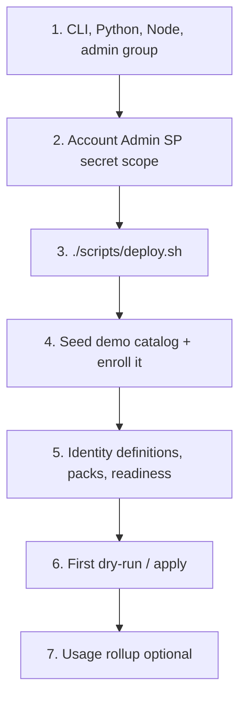

# New environment setup guide

End-to-end checklist to bring the Data Governance App up in a new Databricks workspace,
from an empty metastore to a working demo with masks, row filters, and grants sync.

Feature deep-dives live elsewhere ([grants sync](grants-sync.md),
[masking & row filters](mask-and-row-filter-flows.md),
[usage analytics](usage-analytics.md),
[backend](backend-architecture.md)). This page is only the bootstrap path.



---

## 1. Prerequisites

| Need | Notes |
| --- | --- |
| Databricks CLI | Authenticated to the target workspace (`databricks auth login` or a named profile) |
| Node.js 22+ | Frontend build |
| Python 3.11+ | Backend tests, seed scripts, local `dev.sh` |
| Metastore admin (or equivalent) | Create catalogs, governed tag policies, system-table grants |
| Account Admin service principal | Runs ABAC, grants sync, usage rollup, Account SCIM |
| An admin group | Members become app admins (`admin_group`, default `admins`) |

Clone the repo and create a venv once:

```bash
python3 -m venv .venv
PIP_INDEX_URL=https://pypi-proxy.dev.databricks.com/simple \
  .venv/bin/pip install -r requirements-dev.txt
```

Use your workspace's PyPI index if that proxy is not available.

---

## 2. Account Admin SP and secret scope

Metastore ABAC, grants sync, and the usage job need an **Account Admin** service principal.
The Databricks Apps runtime SP is not enough.

1. Create (or reuse) an Account Admin SP and note its **application ID** and **client secret**.
2. Put the credentials in a secret scope (default name `databricks-governance-app`):

```bash
PROFILE=<your-cli-profile>
SCOPE=databricks-governance-app

databricks secrets create-scope "$SCOPE" --profile "$PROFILE"
databricks secrets put-secret "$SCOPE" client_id --profile "$PROFILE"      # paste application ID
databricks secrets put-secret "$SCOPE" client_secret --profile "$PROFILE"  # paste secret
databricks secrets put-acl "$SCOPE" <your-email> MANAGE --profile "$PROFILE"
```

3. Set the bundle variable `sync_job_run_as_sp` to that same application ID (in
   `databricks.yml`, a target override, or `--var sync_job_run_as_sp=<id>`). The deployer needs
   **Use** on the SP so the sync and usage jobs can `run_as` it.

4. After the first deploy creates the app, grant the Apps SP read access to the scope:

```bash
APP_SP=$(databricks apps get data-governance-app --profile "$PROFILE" -o json \
  | python3 -c 'import json,sys; print(json.load(sys.stdin)["service_principal_client_id"])')
databricks secrets put-acl "$SCOPE" "$APP_SP" READ --profile "$PROFILE"
```

If you deploy again later, re-check that ACL when the Apps SP changes.

---

## 3. Deploy the app

```bash
./scripts/deploy.sh            # target "dev": Lakebase storage
./scripts/deploy.sh dev-delta  # same workspace, Delta storage backend
# overrides:
./scripts/deploy.sh dev --var admin_group=my-admins
./scripts/deploy.sh dev --skip-setup   # code-only redeploy; skips the setup job
```

The script builds the UI, validates and deploys the bundle, runs the setup job (unless
`--skip-setup`), and starts the app. Every step is idempotent.

### What the bundle creates

| Resource | Purpose |
| --- | --- |
| App `data-governance-app` | The UI + API |
| Lakebase project/database | App state when `storage_backend=lakebase` |
| SQL warehouse | Inventory, UDFs, seed scripts |
| Job `…-setup` | Idempotent provisioning (see below) |
| Job `…-data-access-sync` | Grants sync (dry-run / apply) |
| Job `…-usage-rollup` | Daily usage analytics |

### What the setup job does

In order:

1. **Catalogs** — app catalog / schema (`data_governance_app.app` by default)
2. **Delta storage** — app Delta tables when needed
3. **Masking functions** — `has_sensitivity`, geo mask UDFs
4. **App permissions** — grants for the Apps SP
5. **Admin SP permissions** — Lakebase / catalog grants for the Account Admin SP
6. **Usage analytics** — `{app_catalog}.usage` schema and system-table grants when allowed

On metastores without Default Storage or a root location, set `catalog_managed_location`.

### Main bundle variables

| Variable | Default | Role |
| --- | --- | --- |
| `storage_backend` | `lakebase` | `lakebase` or `delta` |
| `app_catalog` / `app_schema` | `data_governance_app` / `app` | App-owned Delta / UC mirrors |
| `admin_group` | `admins` | Who is an app admin |
| `admin_secret_scope` | `databricks-governance-app` | Account Admin SP secrets |
| `sync_job_run_as_sp` | (workspace-specific) | Account Admin SP application ID |
| `warehouse_min_clusters` / `warehouse_max_clusters` | `1` / `4` | Dedicated warehouse size |

Open the app URL printed at the end of `deploy.sh`. Confirm you are an admin (member of
`admin_group`). App status and Data Access → readiness should already show warehouse and
credential checks; Identity definitions will still be missing.

---

## 4. Demo catalog, tags, and enrollment

Deploy does **not** create customer/demo tables. Use the scripts under `scripts/` for that.

### 4a. Seed the demo catalog

Creates catalog **`data_governance_demo`**, FEMA-domain schemas, tables with sample rows, and
cross-domain views.

**Default (also tags):** applies the demo tag set and extends governed tag policies
(`data_access_control`, `clr_review_status`, `sensitivity_category`, `sensitivity`), plus column
tags for masks and row filters:

```bash
.venv/bin/python scripts/seed_data_governance_demo.py \
  --profile "$PROFILE" \
  --warehouse-id <sql-warehouse-id>
```

**Other environments / custom tag keys:** create objects only, then tag yourself:

```bash
.venv/bin/python scripts/seed_data_governance_demo.py \
  --profile "$PROFILE" \
  --warehouse-id <sql-warehouse-id> \
  --no-tags
```

`--no-tags` skips tag-policy create/update and every `SET TAGS` on catalog, schema, table,
column, and view. Use it when this workspace’s access/review tags are not the demo defaults.

Safe to re-run: catalogs/schemas/tables use `IF NOT EXISTS`; empty tables get rows once.

With the default (tagged) mode, the **access tag key** is hard-coded as `data_access_control`.
Only the **catalog name** is `data_governance_demo`.

### 4b. Enroll catalogs in the governance perimeter

Sync and Access Explorer only see catalogs tagged `data_access_controlled=true`.

```bash
.venv/bin/python scripts/enroll_governance_catalogs.py \
  --profile "$PROFILE" \
  --warehouse-id <sql-warehouse-id>
```

Edit the `CATALOGS` tuple in that script for the catalogs you want (include
`data_governance_demo` after seeding). Or tag by hand:

```sql
ALTER CATALOG `data_governance_demo` SET TAGS ('data_access_controlled' = 'true');
```

When the app first sees an enrolled catalog, it grants the Account Admin SP `MANAGE`,
`USE CATALOG`, `USE SCHEMA`, and `SELECT` on it (also attempted by the setup job).

### Tag policies the product expects

| Tag key | Role |
| --- | --- |
| `data_access_control` | Table access path (`finance`, `finance.budget`, …) |
| `clr_review_status` | Must be `reviewed` on the **table** for grants eligibility |
| `data_access_controlled` | Catalog enrollment (`true`) |
| `sensitivity_category` + `sensitivity` | Mask required path |
| `mask_rule` / `data_type` | Which mask handler to apply (pack sync maintains values) |
| `row_filter` | Dimension key on filtered columns (pack sync maintains values) |

The seed script creates the first four. Mask and row-filter tag values are completed when you
sync the packs in the app.

---

## 5. Configure the app (UI)

Do these as an app admin after deploy + seed/enroll.

### 5a. Identity → Definitions

Create exactly one of each:

1. **Sensitivity** — key `sensitivity`, governed tags `sensitivity_category` + `sensitivity`
2. **Data access** — key `data_access` (recommended), governed tags must include
   `data_access_control`

Allowed values come from the governed tag policies (including paths the seed script added).

Optional: **Approvers** tab — map path prefixes to approver groups for request routing.

### 5b. Mask rules

1. Open **Mask rules** → seed default built-in rules (if the registry is empty).
2. **Sync / ensure pack** so UC functions, the `mask_rule` tag values, and the metastore mask
   policies exist.

### 5c. Row filters

1. Create dimensions you need (the demo uses `state`).
2. Attach dimensions to columns as needed (seed already tags some columns `row_filter=state`).
3. **Sync / ensure pack** for the row-filter UDF and policy.

### 5d. Policy exceptions (optional)

Add principals that should sit on the pack `EXCEPT` list (unmasked / unfiltered).

### 5e. Data Access settings and readiness

On **Data Access**:

1. Confirm **Access tag** is `data_access_control` (read-only in the form; owned with the
   Identity data-access definition).
2. Confirm review tag/value (`clr_review_status` / `reviewed`), group prefix (`dac_`), and
   enrollment tag (`data_access_controlled` / `true`).
3. Open readiness. For a first **dry-run** you need credentials, warehouse, tag read, and group
   list. For **apply** you also need the sensitivity and data-access definitions and grant
   probes.

---

## 6. First grants sync

1. **Dry-run** from Data Access (or the sync Job in dry-run mode). Inspect the plan: groups to
   create, grants to add/revoke, membership changes.
2. Assign data-access attribute values to a test user (Identity → Assignments) that match a
   reviewed table path in `data_governance_demo`.
3. **Apply** when readiness is green. Membership for new approvals is applied immediately;
   table `GRANT`/`REVOKE` follows the sync Job.

Schedule: enable the Job schedule in settings when you are ready for recurring runs. Prefer
dry-run until the plan looks right.

---

## 7. Usage analytics (optional)

Prerequisites (see [usage-analytics.md](usage-analytics.md)):

1. Account Admin SP is `run_as` for the usage Job and can read system access/query tables.
2. If setup could not grant system tables, run as metastore admin:

```sql
GRANT USE CATALOG ON CATALOG system TO `<account-admin-sp-application-id>`;
GRANT USE SCHEMA, SELECT ON SCHEMA system.access TO `<account-admin-sp-application-id>`;
GRANT USE SCHEMA, SELECT ON SCHEMA system.query TO `<account-admin-sp-application-id>`;
```

3. Enrolled catalogs exist (otherwise the rollup succeeds with an empty window).

Trigger:

```bash
databricks bundle run usage_rollup -t dev \
  --params trigger=user,actor=you@example.com
```

Then open **Data access → Analytics** (usage / access / sync tabs).

---

## 8. Script catalog

| Script | When to run | What it does |
| --- | --- | --- |
| `scripts/deploy.sh` | Every environment / release | Build UI, deploy bundle, setup job, start app |
| `scripts/dev.sh` | Local development | API `:8000`, Vite UI `:5173`, in-memory or remote storage |
| `scripts/seed_data_governance_demo.py` | After deploy, for a demo | Catalog `data_governance_demo` + tables/views; add `--no-tags` to skip tagging |
| `scripts/enroll_governance_catalogs.py` | After catalogs exist | Enrollment tag policy + tag catalogs in its `CATALOGS` list |
| `scripts/catalog_policies.py` | Optional fallback | Apply mask/row-filter policies at **catalog** scope if metastore ABAC is unavailable |
| `scripts/perf_grants.py` | Load / scale testing | 2.5k–5k tables in `….perf_test`, assignments, timed sync runs |
| `scripts/mask_column_perf.py` | Mask cost experiments | Measure `SELECT *` as more columns become masked |
| `scripts/perf/load_test.py` | UI/API load test | Concurrent read-only sessions against a deployed app |

`deploy.sh` never calls the seed, enroll, or perf scripts. Re-run them yourself when you need
demo or test data.

### Catalog policy backup (optional)

```bash
.venv/bin/python scripts/catalog_policies.py apply --catalog data_governance_demo
.venv/bin/python scripts/catalog_policies.py status --catalog data_governance_demo
```

### Grants sync performance harness (optional)

```bash
.venv/bin/python scripts/perf_grants.py pause
.venv/bin/python scripts/perf_grants.py principals
.venv/bin/python scripts/perf_grants.py seed --stage 1
.venv/bin/python scripts/perf_grants.py run --mode dry_run --label stage1
.venv/bin/python scripts/perf_grants.py report
.venv/bin/python scripts/perf_grants.py cleanup   # when finished
```

Default target catalog inside that script is still the older live name unless you change
`CATALOG` at the top of the file.

---

## 9. Local development (optional)

```bash
DATABRICKS_CONFIG_PROFILE="$PROFILE" ./scripts/dev.sh
```

- API on `:8000`, UI on `:5173`
- Caller identity comes from the CLI profile (or `DEV_USER_EMAIL`)
- Storage defaults to in-memory unless you point at Lakebase/Delta
- `ALLOW_LOCAL_IDENTITY=true` is set by `dev.sh` (required for local calls without Apps proxy headers)

```bash
.venv/bin/pytest && .venv/bin/ruff check backend provisioning
cd frontend && npm test && npm run typecheck
```

---

## 10. Checklist

Copy this for a new workspace:

- [ ] CLI profile works against the workspace
- [ ] Account Admin SP created; `client_id` / `client_secret` in secret scope
- [ ] `sync_job_run_as_sp` matches that SP; deployer has Use on it
- [ ] `admin_group` exists and includes you
- [ ] `./scripts/deploy.sh` completed; app URL opens; you are an admin
- [ ] Apps SP has `READ` on the secret scope
- [ ] `seed_data_governance_demo.py` completed (or your own tagged tables exist)
- [ ] Demo (or real) catalogs enrolled with `data_access_controlled=true`
- [ ] Identity definitions: sensitivity + data access
- [ ] Mask rules seeded + pack ensured
- [ ] Row-filter dimensions + pack ensured
- [ ] Data Access readiness green for dry-run (and apply when ready)
- [ ] Dry-run inspected; apply run succeeded for a test path
- [ ] (Optional) system table grants + usage rollup job run
- [ ] (Optional) Recovery Git settings if you use config export

---

## 11. Troubleshooting pointers

| Symptom | Likely cause | Where to look |
| --- | --- | --- |
| Not an app admin | Not in `admin_group` | Bundle var + workspace group membership |
| Readiness `credentials` / `authenticate` fail | Secret scope missing or Apps SP lacks READ | Section 2; App status |
| Dry-run sees no tables | Catalog not enrolled or missing review tag on **table** | Section 4b; [grants-sync](grants-sync.md) |
| Apply blocked on definitions | Sensitivity / data-access definition missing | Identity → Definitions |
| Masks not applying | Pack not synced; column missing sensitivity tags | Mask rules → ensure pack |
| Usage empty | No enrolled catalogs, or Admin SP cannot read `system.access` | Section 7 |
| Setup job cannot create catalogs | No Default Storage / root | Set `catalog_managed_location` |

Activity panel (top bar) shows long-running tasks and recent errors with a reference id.
Performance → Requests / Tasks holds admin history across users.
