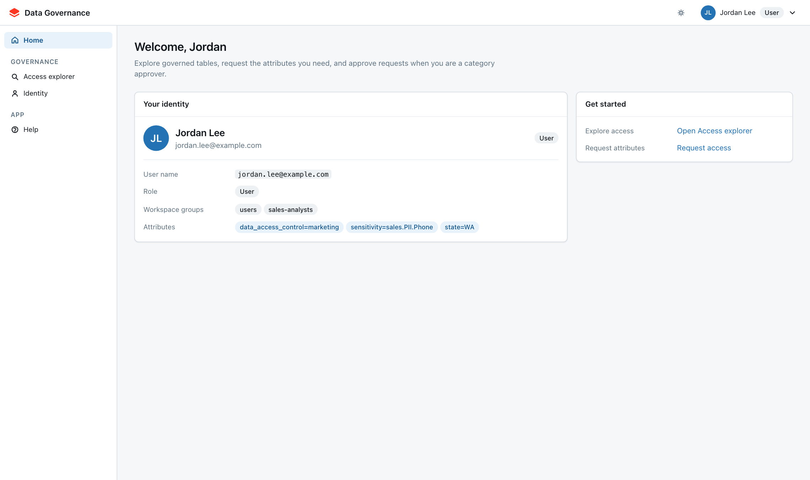
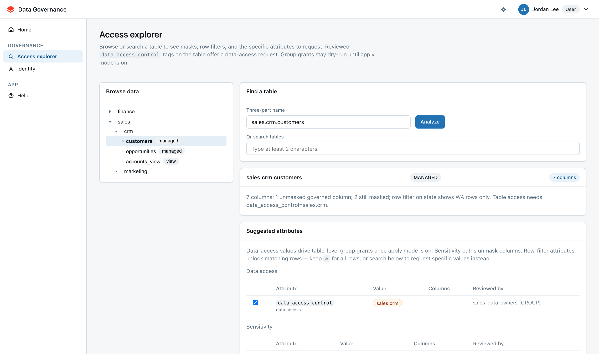
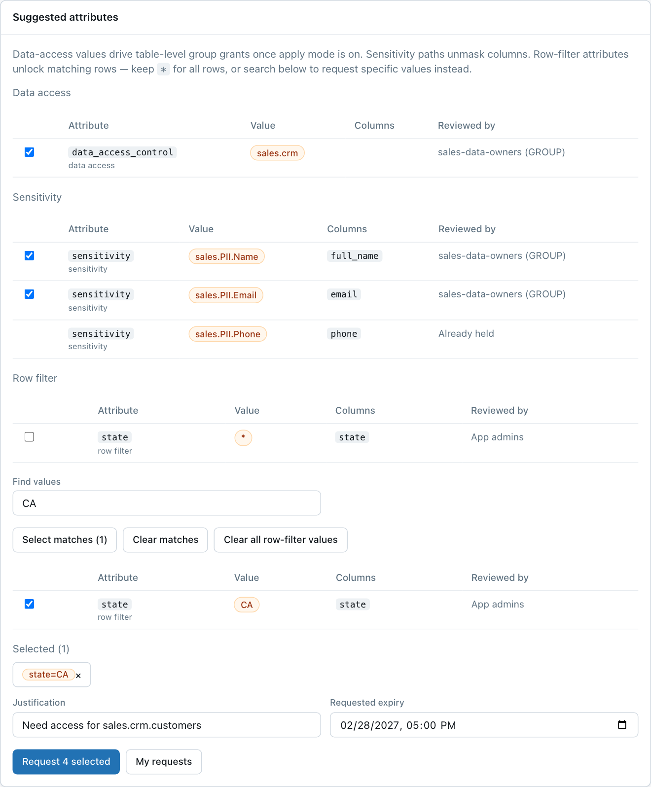
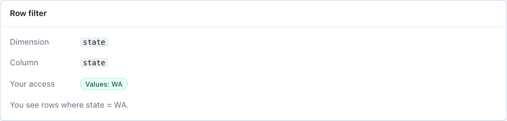
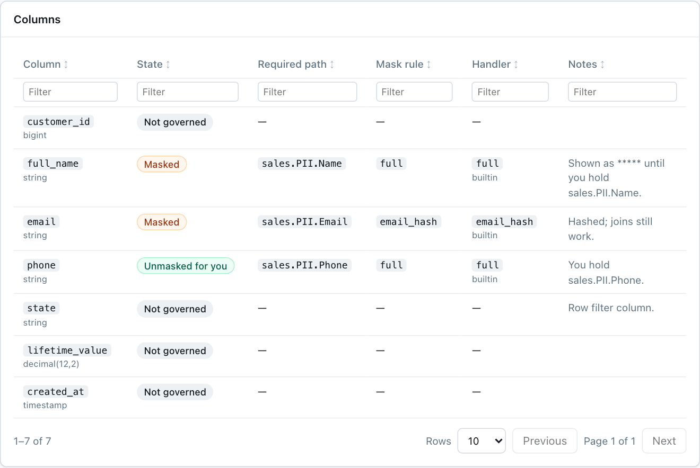
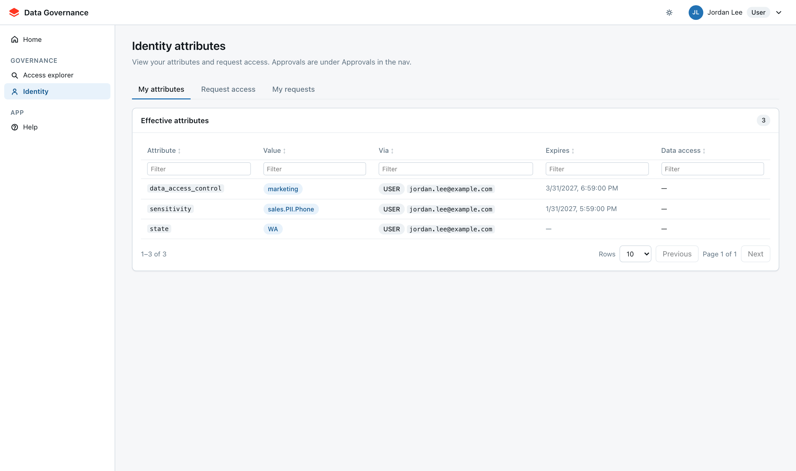
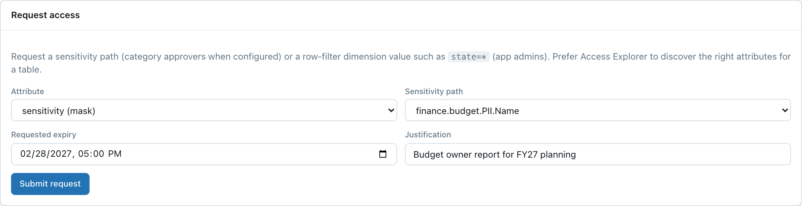
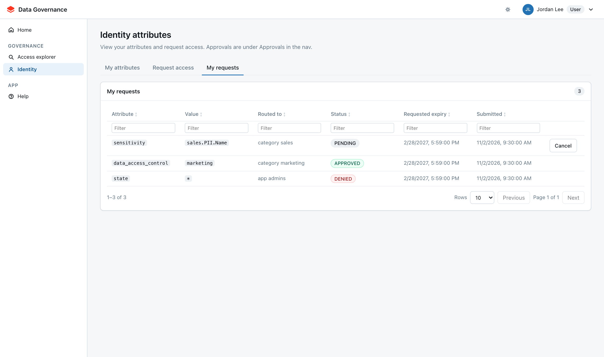

# User guide

This guide is for anyone who uses the app to find data and request access. You do not need
admin rights for anything here. The screenshots use demo data: Jordan Lee, a sales analyst,
looking at the `sales.crm.customers` table.

---

## How access works in one minute

Tables in Unity Catalog are protected in three layers. The app tells you which ones apply to a
table and what to ask for.

| Layer | What it controls | What you request |
| --- | --- | --- |
| **Data access** | Whether you can query the table at all | A `data_access_control` value such as `sales.crm` |
| **Sensitivity (masks)** | Whether sensitive columns show real values or masked ones | A sensitivity path such as `sales.PII.Name` |
| **Row filter** | Which rows you see | A dimension value such as `state=WA`, or `state=*` for all rows |

Each thing you hold is called an **attribute**. Approvers grant attributes, and attributes can
expire. Masked columns still appear in your results, but their values are redacted or hashed
until you hold the matching sensitivity path.

---

## Your home page

**Home** shows who the app thinks you are: your user name, workspace groups, and every attribute
you currently hold. Use **Get started** to jump straight to Access explorer or a manual request.

As a user, the side nav shows **Home**, **Access explorer**, **Identity**, and **Help**. Admin
pages (Policies, Row filters, Data access, and others) are hidden.

---

## Access explorer: find out what you need for a table

Access explorer answers one question: *for this table, what can I see today, and what exactly
should I request?* It is the fastest way to ask for access, because it works out the attributes
for you.

### Step 1: pick a table

Use whichever is easiest:

- **Browse data** — expand a catalog, then a schema, and click a table.
- **Three-part name** — type `catalog.schema.table` and click **Analyze** (or press Enter).
- **Or search tables** — type at least two characters of a name and click **Analyze** on a
  result.

The table name is saved in the page URL (`?table=`), so you can bookmark it or send the link to
a colleague.

### Step 2: read the summary

The card under the search shows the table name, its type, the column count, and a one-line
summary, for example: *2 columns still masked; row filter on state shows WA rows only*.

### Step 3: choose what to request

**Suggested attributes** lists only the specific values this table needs — never broader
parent paths. Rows are grouped by layer, and each row shows which columns it affects and who
will review it.

- Everything you are missing is **checked by default**. Uncheck anything you do not need.
- Rows labelled **Already held** have no checkbox. You have that attribute already
  (`sales.PII.Phone` above, which is why the `phone` column is unmasked).
- **Reviewed by** names the approver group for that path, or **App admins** when no approver is
  configured.

### Step 4: decide how many rows you need

For a row-filtered table, **`*` (all rows)** is selected by default. If you only need some
values — for example your own territory — request those instead:

1. Type in **Find values** (for example `CA`).
2. Click **Select matches**. The matching values are checked and `*` is unchecked for that
   dimension automatically.
3. Check **Selected** to confirm what will be requested. Click **×** on a chip to remove it,
   or **Clear all row-filter values** to start over.

You can hold `*` or specific values for a dimension, not both, so selecting one clears the
other.

### Step 5: submit

1. Edit the **Justification** if needed. It starts as *Need access for* the table name; a
   specific reason (project, ticket, report) gets approved faster.
2. Pick a **Requested expiry**. Ask for what you need; approvers may shorten it.
3. Click **Request N selected**. One request is created per attribute, and a confirmation
   lists who each one went to.

### Check columns and rows

Below the suggestions, **Row filter** shows the dimension, the filtered column, and the rows
you can see today.

**Columns** lists every column with its state:

| State | Meaning |
| --- | --- |
| **Unmasked for you** | Governed, and you hold the required path, so you see real values |
| **Masked** | Governed; values are redacted or hashed until you hold the **Required path** |
| **Not governed** | No mask applies; everyone with table access sees it |

The **Mask rule** and **Handler** columns tell you how a value is masked. For example
`email_hash` keeps values joinable without revealing them.

---

## Identity: your attributes and requests

**Identity** has three tabs.

### My attributes

Every attribute you hold, how you got it (**Via** your user or a group), and when it expires.
Attributes that come from a group stay in place as long as you are in that group.

### Request access

Use this when you already know the exact attribute and value, for example when a colleague
tells you "ask for `finance.budget.PII.Name`". Choose the attribute, pick the value, set an
expiry and justification, and click **Submit request**.

If you are starting from a table, Access explorer is easier: it works out the values for you.

### My requests

Every request you have opened, where it was routed, its status, and when you submitted it.

| Status | What it means | What you can do |
| --- | --- | --- |
| **PENDING** | Waiting for an approver | **Cancel** it if you no longer need it |
| **APPROVED** | The attribute is now yours | Re-analyze the table to confirm |
| **DENIED** | The approver declined | Read the note, adjust, and request again |
| **CANCELLED** | You withdrew it | Nothing |

---

## After you request

1. The request goes to the **approver** for that path, or to app admins when none is
   configured.
2. When it is approved, the attribute is assigned to you until the approved expiry.
3. **Sensitivity** and **row-filter** changes take effect on your next query.
4. **Data access** adds you to the table's managed group right away. The table grant itself
   can wait for the next grants sync, so allow some time before you query a new table.
5. Open Access explorer and analyze the table again to confirm the columns and rows look right.

---

## Labels you may see

| Label | Meaning |
| --- | --- |
| **Already held** | You already have this attribute; no need to request it again |
| **Not requestable yet** | The attribute is not set up for requests yet; ask an app admin |
| A group name in **Reviewed by** | That approver group will review the request |
| **App admins** | No approver is configured for that path, so app admins review it |

---

## FAQ

**A column is still masked after my request was approved.** Check **My attributes** for the
exact path in the column's **Required path**. A path only unmasks columns at or below it, so
`sales.PII.Email` does not unmask `sales.PII.Name`.

**I can query the table but see no rows.** The table has a row filter and you hold no value for
its dimension. Request `*` or the values you need.

**My request went to App admins instead of a named group.** No approver is configured for that
path or dimension. That is expected for many row-filter dimensions.

**My access is about to expire.** Request the same attribute again before it expires. For
sensitivity paths, approvers also see expiring access in their inbox and can renew it.
